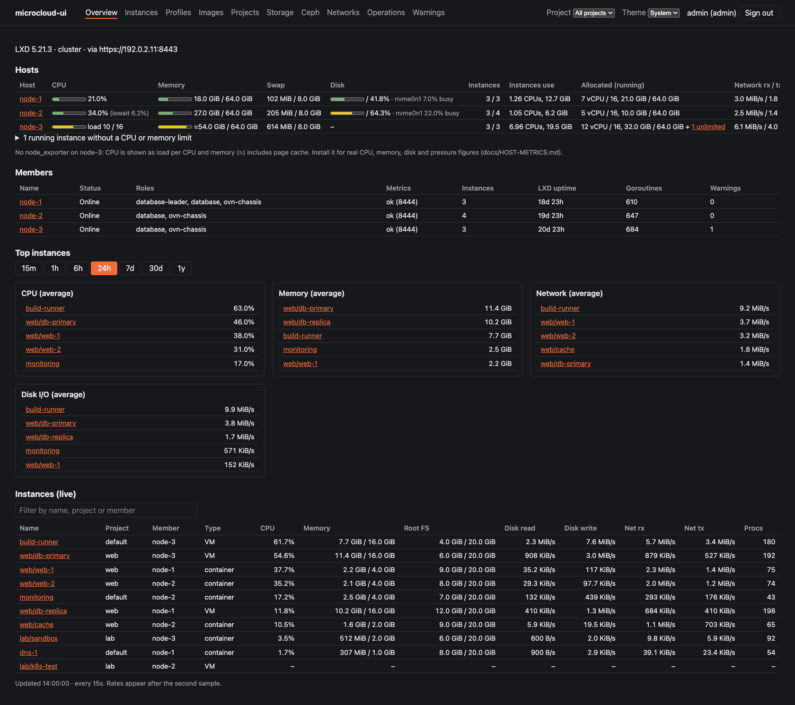
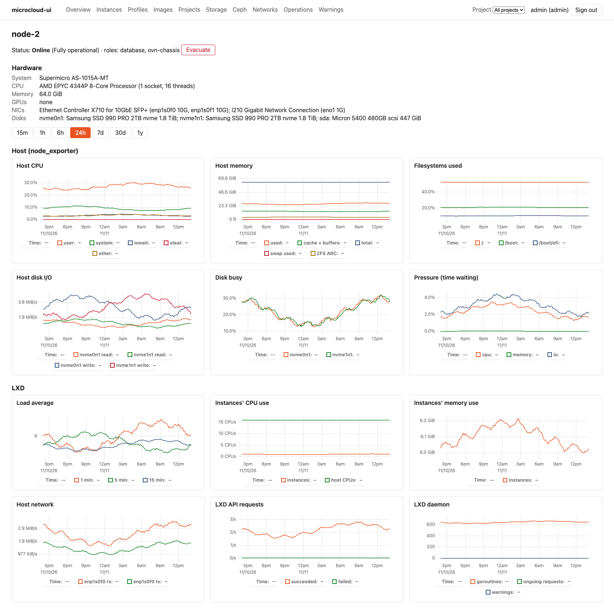
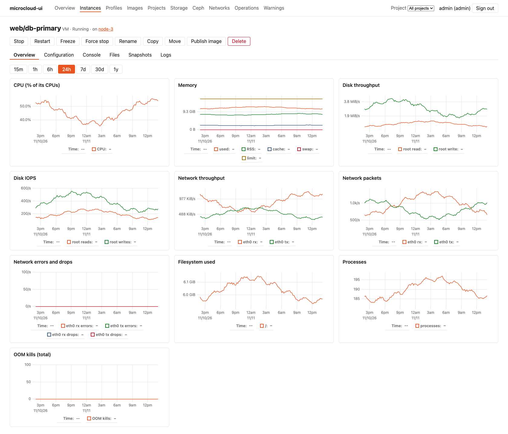
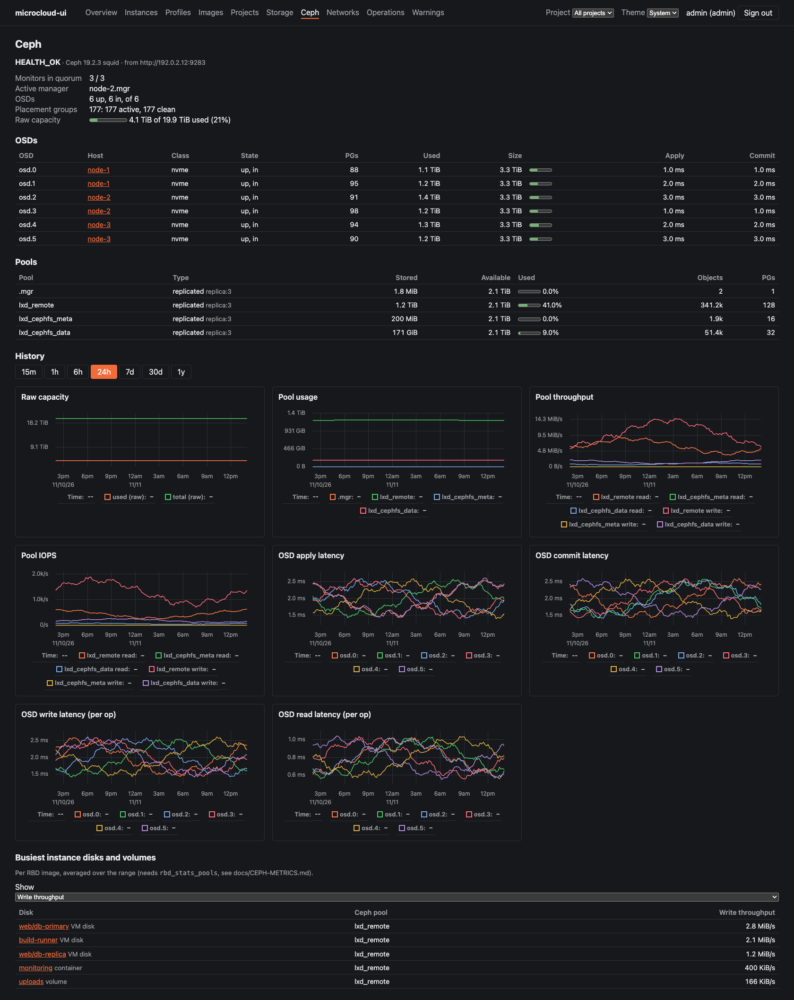
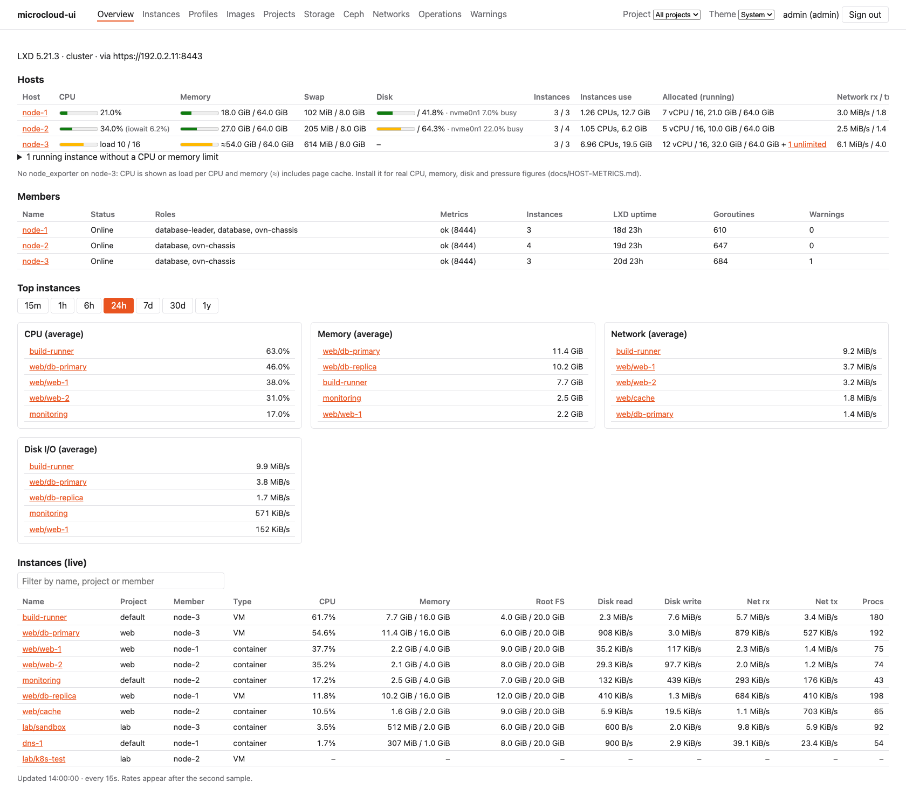

# microcloud-ui

A web UI for Canonical MicroCloud (LXD, MicroCeph, MicroOVN) with built-in
metrics: per-instance CPU/memory/disk/network history, Ceph and local storage
usage, and OVN network visibility.

**Status:** Phases 1–4 built: connectivity, local auth, metrics history and graphs, management of instances (create, lifecycle, config, snapshots, terminal, consoles, files), profiles, images, projects, networks (incl. ACLs and forwards), storage pools and custom volumes, plus Ceph and OVN dashboards and a Hosts view (optional node_exporter, [`docs/HOST-METRICS.md`](docs/HOST-METRICS.md)). Owner live checks: [`docs/LIVE-TESTS.md`](docs/LIVE-TESTS.md). See [`docs/REQUIREMENTS.md`](docs/REQUIREMENTS.md),
[`docs/PLAN.md`](docs/PLAN.md) and the design log in [`agents.md`](agents.md).

**Running it for real:** an offline bundle (`make bundle`) installs on Ubuntu as a
hardened systemd service serving HTTPS. There's also a container image
(`ghcr.io/moon127/microcloud-ui`, or `make image`) for a Podman Quadlet or Docker Compose.
Releases attach the bundles and publish the image; `:edge` and the **edge** pre-release
follow `main` ([`docs/RELEASING.md`](docs/RELEASING.md)). Either can sit behind NGINX Proxy Manager, Cosmos, Caddy
or nginx, which then handle Let's Encrypt certificates. See [`docs/DEPLOY.md`](docs/DEPLOY.md).

## Screenshots

From an invented demo cluster (`make screenshots`), not a real one. Shown in the dark
theme; the Theme menu in the top bar switches between Light, Dark and System (follows the OS).

**Overview:** hosts (CPU, memory, disk, allocation), members, top instances, live table


**Member:** hardware, host graphs from node_exporter, LXD graphs


**Instance:** actions, tabs, history graphs


**Ceph:** health, OSDs, pools, history, busiest disks mapped to instances


More: [instances](docs/screenshots/instances.png) ·
[create instance](docs/screenshots/create-instance.png) ·
[storage](docs/screenshots/storage.png) ·
[networks](docs/screenshots/networks.png) ·
[OVN](docs/screenshots/ovn.png)

**Light theme**


## Development setup

Requires **Python 3.10+**, **Node 20+** (22 recommended) and `make`.
On macOS: `brew install python@3.12 node` (the bundled `python3` may be too old).

```bash
git clone <repo> microcloud-ui && cd microcloud-ui

# Python backend in a virtual environment (created at ./.venv)
python3 -m venv .venv
source .venv/bin/activate
pip install --upgrade pip
pip install -e "backend[dev]"          # editable install + test/lint tools

# Frontend
cd frontend && npm ci && cd ..

# or do both in one go:  make install

make hooks                             # optional: lint + tests run before every commit
```

`make help` lists every target. The common ones:

| Command | What it does |
|---|---|
| `make test` | backend `pytest --cov` + frontend `vitest --coverage`; fails below 90% |
| `make lint` | ruff, ruff format check, mypy (strict), eslint, tsc, shellcheck |
| `make dev-backend` | API with auto-reload on http://127.0.0.1:8000 |
| `make dev-frontend` | Vite dev server on http://localhost:5173, proxying `/api` to :8000 |
| `make serve` | build the SPA and serve everything from the backend on :8000 |
| `make bundle` | offline Ubuntu install bundle in `dist/` ([`docs/DEPLOY.md`](docs/DEPLOY.md)) |
| `make image` / `make image-save` | container image with podman or docker; saved as a tarball in `dist/` |
| `make screenshots` | rebuild `docs/screenshots/` from the demo cluster (headless Google Chrome) |

Use a different venv location with `make test VENV=~/venvs/mcui`.

Leave the venv with `deactivate`.

## Manual run for development (macOS)

For prototyping only; production uses the systemd unit or container image (Phase 7).

```bash
source .venv/bin/activate

# Terminal 1: backend with auto-reload
mcui serve --reload                    # or: make dev-backend
curl http://127.0.0.1:8000/api/health  # {"status":"ok","version":"..."}

# Terminal 2: frontend with hot reload
cd frontend && npm run dev             # open http://localhost:5173

# Or a single process serving the built SPA:
make serve                             # open http://127.0.0.1:8000
```

Without a config file these run on built-in defaults: no cluster, no users (so the login
page can't be passed) and data in `./data`. `mcui serve` says which it's using on its
first line. To use the UI, connect it to your MicroCloud as below.

## Connecting to your MicroCloud

1. Create the certificates and trust them in LXD: [`docs/LXD-CREDENTIALS.md`](docs/LXD-CREDENTIALS.md).
2. Write a `config.toml` (git-ignored), e.g. `~/.config/mcui/config.toml`; see
   [`docs/CONFIGURATION.md`](docs/CONFIGURATION.md). For plain-http local dev set
   `secure_cookies = false` under `[server]`.
3. Check it, create a login, and run. Every `mcui` command (so `make serve` and
   `make dev-backend` too) reads `-c <file>`, else `$MCUI_CONFIG`, else
   `~/.config/mcui/config.toml` if it exists. With the config there, nothing needs
   naming:

```bash
mcui check                             # endpoints, trust, members, metrics, features
mcui user add admin --role admin       # prompts for a password
make serve                             # or: make dev-backend (+ npm run dev for Vite)
```

Sign in at http://127.0.0.1:8000 (`make serve`) or http://localhost:5173 (Vite).
Pages: Overview (hosts, members, top instances, live table), Instances (filters, bulk
actions, create wizard) and an instance page (graphs, configuration, console and
terminal, files, snapshots, logs), Profiles, Images, Projects, member pages
(hardware, graphs, evacuate/restore), Storage (pools with per-member capacity,
custom volumes with snapshots and attach/detach), Ceph (health, OSDs, pools,
latency, busiest disks), Networks (create/edit per member, ACLs, forwards, leases,
OVN overview), Operations and Warnings. Admins can change things; viewers read only. Pick the time range (15 min to 1 year) above
the graphs. History is collected in the background into `<data_dir>/metrics.db`.

Other user commands: `mcui user list`, `mcui user passwd <name>` (also signs the user
out), `mcui user delete <name>`. Admins can do the same through the `/api/users`
endpoints. Users live in the config's `data_dir`, so a server started with another
config (or none) doesn't know them.

### Live tests and fixtures (run on a machine that reaches the cluster)

```bash
cd backend
MCUI_IT_CONFIG=~/.config/mcui/config.toml ../.venv/bin/pytest tests/integration -q --no-cov
../.venv/bin/mcui -c ~/.config/mcui/config.toml record-fixtures --out tests/fixtures/recorded
```

`record-fixtures` replaces IPs, MACs, fingerprints and certificates with
placeholders; review the files before committing them.

> If you copy `frontend/node_modules` between machines (e.g. from a Linux VM),
> delete it and run `npm ci` again: it contains platform-specific binaries.

### Moving development to a new machine

The repository holds no secrets. Everything reads one config file, kept outside the
repo at `~/.config/mcui/config.toml`:

- `mcui` (the server, `check`, `user`, `record-fixtures`, and so `make serve` and
  `make dev-backend`): `-c <file>`, else `$MCUI_CONFIG`, else
  `~/.config/mcui/config.toml` if it exists.
- `scripts/lxd_api.py`: `$MCUI_CONFIG`, else `~/.config/mcui/config.toml`.
- the integration tests: `$MCUI_IT_CONFIG`.

A new machine, or a new Claude Code session on it, picks everything up once those files
exist.

1. **Clone and install:** `git clone …`, then `make install`. This sets up `.venv` and
   `frontend/node_modules`; don't copy either between machines. Run `make hooks` if you
   want the pre-commit check.
2. **Copy from the old machine** (for example with `scp -r`):

   | What | Where |
   |---|---|
   | Config | `~/.config/mcui/config.toml` |
   | Cluster certificate (pinned) | `~/.config/mcui/certs/lxd-cluster.crt` |
   | Management certificate and key | `~/.config/mcui/certs/client.crt`, `client.key` |
   | Metrics certificate and key, if the config uses them | `~/.config/mcui/certs/metrics.crt`, `metrics.key` |
   | node_exporter password file and CA, if `[node_exporter]` uses HTTPS and auth | the paths named there |
   | Metric history and local users (optional) | `~/.local/share/mcui/` (the config's `data_dir`) |

3. **Fix the permissions**, because the app refuses keys that others can read:
   `chmod 700 ~/.config/mcui/certs && chmod 600 ~/.config/mcui/certs/*.key`.
4. **Check the paths** in the config. Paths written with `~/` carry over.
5. **Check the network:** the machine must reach every member on 8443, plus 9100
   (node_exporter) and 9283 (Ceph mgr) if you use them.
6. **Test it:**
   - `.venv/bin/mcui check` should be all OK.
   - `.venv/bin/python scripts/lxd_api.py GET "/1.0/instances?project=mcui-test"` should
     answer.
   - If you didn't copy `data_dir`, there are no users yet:
     `.venv/bin/mcui user add <name> --role admin`.
   - Then run `make serve`; its first line should name your config.

**Same certificates or new ones?** Copying the existing ones is simplest: LXD already
trusts them, so nothing changes on the cluster. If you'd rather keep keys on one machine,
make new ones on the new machine instead. Trust them in LXD
([`docs/LXD-CREDENTIALS.md`](docs/LXD-CREDENTIALS.md) §1–4), then revoke the old machine's
(§ Revoking).

A Claude Code session never needs a secret pasted into the chat. It uses these files
through the app and `scripts/lxd_api.py`. [`CLAUDE.md`](CLAUDE.md) briefs a new session on
the rules, the test cluster and the gotchas.

## LXD certificates

The backend talks to LXD with mutual TLS; browsers never need a certificate.
Step-by-step guide covering key generation on macOS, trusting the certs in
LXD, fetching the shared `cluster.crt` for verification, and testing with
curl: [`docs/LXD-CREDENTIALS.md`](docs/LXD-CREDENTIALS.md).
Configuration reference, including how to switch metrics to a dedicated port:
[`docs/CONFIGURATION.md`](docs/CONFIGURATION.md).
Never commit certs or keys (they are git-ignored).

## Licence

MIT, see [`LICENSE`](LICENSE).
