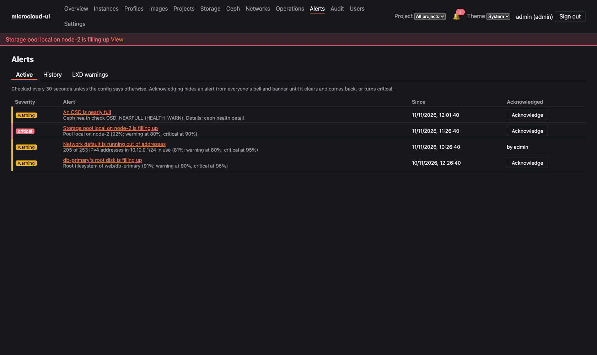
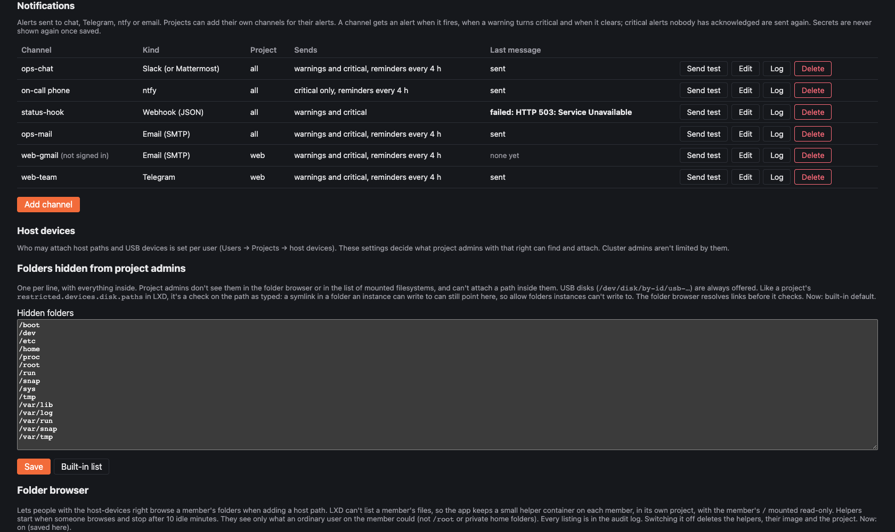
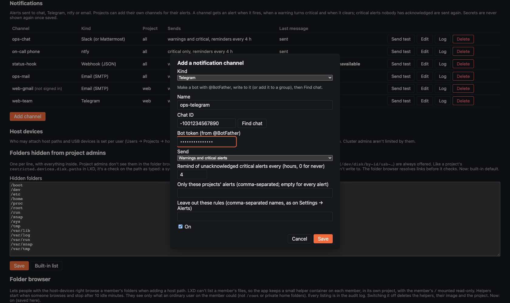
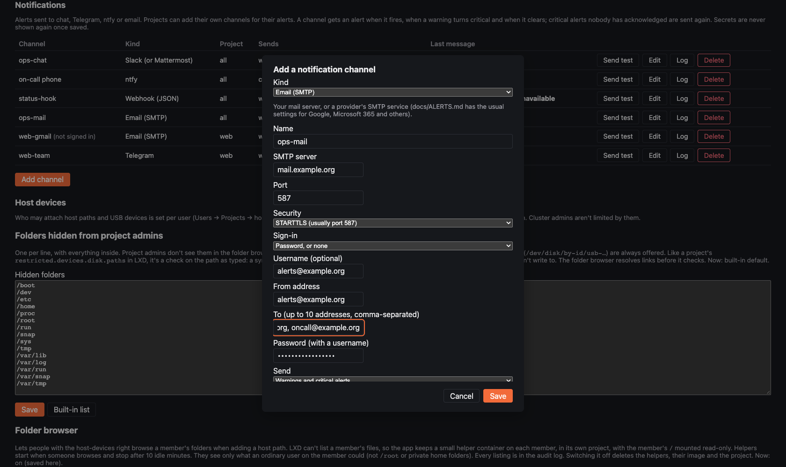
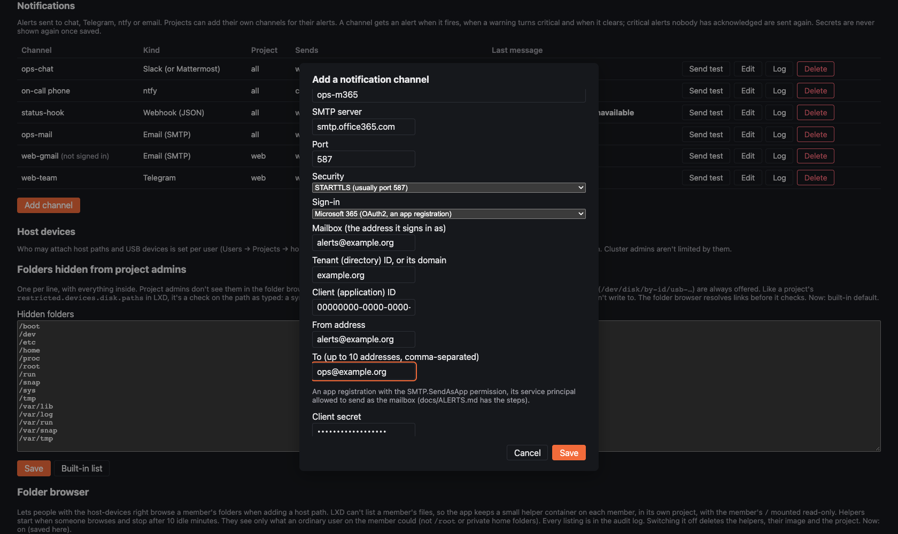

# Alerts

microcloud-ui checks the cluster every 30 seconds and raises an alert when something
needs attention: a Ceph OSD nearly full, a storage pool or host disk filling up, a member
offline, a network running out of addresses. Alerts show on every page and are recorded,
so you can see what happened while you weren't looking. (Phase 8a, D91.) They can also be
sent to chat, Telegram, ntfy, email or a webhook ([below](#sending-alerts-out)).



## Seeing them

- **The bell** in the top bar counts the alerts nobody has acknowledged; red with any
  critical one, amber with warnings.
- **A toast** pops up, on whatever page you're on, when a new alert fires or a warning
  turns critical. Warnings go after 20 seconds; critical ones stay until you dismiss them,
  the alert clears or someone acknowledges it. A newly opened tab doesn't announce what
  was already active; reloading a tab doesn't repeat its toasts.
- **A banner** under the top bar stays while any critical alert is unacknowledged.
- **The Alerts page** (it replaces Warnings):
  - **Active**: what's wrong now, with a link to the page that shows it.
    **Acknowledge** hides an alert from everyone's bell and banner until it clears and
    comes back, or a warning turns critical; it stays on this list.
  - **History**: alerts that cleared, when, and how long they lasted (kept 90 days).
  - **LXD warnings**: LXD's own warnings, as before (cluster roles).

**Who sees what:** cluster admins and viewers see every alert. A project user sees only
their projects' alerts: their instances running out of memory or root disk, their
project nearing its limits, and the project's own networks (with `features.networks`)
running out of addresses. A cluster admin can acknowledge any alert, a project admin
their project's. Alerts follow a renamed project; a deleted project's alerts clear and
only cluster roles see them afterwards.

## What's checked

| Alert | When (defaults) | From |
|---|---|---|
| Ceph's health checks | whenever Ceph raises one: `OSD_NEARFULL`, `OSD_FULL`, `POOL_NEARFULL`, `OSD_DOWN`, `MON_DOWN`, `MON_DISK_LOW`, `PG_DEGRADED`, `SLOW_OPS`, `MON_CLOCK_SKEW`, `RECENT_CRASH` and any other; `HEALTH_ERR` ones are critical. Each links to its part of the Ceph page: monitor checks to Monitors, OSD and pool checks to their tables | the Ceph mgr |
| Ceph filling up | raw capacity used ≥ 75% (critical 85%), before Ceph's own warnings | the Ceph mgr |
| Ceph pools filling up | a pool ≥ 80% (90%) used as Ceph counts it (`ceph df`'s %USED): its copies, and space only up to the OSD that would be full first. This can be high while raw use looks comfortable, e.g. when a bigger host's extra space can't be used ([`CEPH-METRICS.md`](CEPH-METRICS.md#balance-and-capacity)). It warns before Ceph's own `POOL_NEARFULL`, which comes with an OSD at nearfull. Pool quotas aren't counted (LXD doesn't set them) | the Ceph mgr |
| Local storage pools | ZFS, LVM, btrfs or dir pool on a member ≥ 80% (90%) | LXD |
| Host filesystems | any real filesystem on a member ≥ 85% (95%), counted as `df` does | node_exporter |
| Host memory | ≥ 90% (95%) in use | node_exporter |
| Host clocks | not synchronised (Ceph and OVN need it) | node_exporter |
| Members | offline (critical) or evacuated (warning); offline shows about a minute after LXD itself notices, which can take two | LXD |
| LXD security | a member's LXD release misses a security fix | LXD |
| Instances out of memory | processes killed for lack of memory in the last 10 minutes | LXD metrics |
| Instance root disks | ≥ 90% (95%) | LXD metrics |
| Project limits | any `limits.*` ≥ 90% (98%) | LXD |
| OVN uplink | router addresses used from `ipv4.ovn.ranges` ≥ 80% (95%) | LXD |
| Network addresses | IPv4 addresses in use in a bridge or OVN network's subnet ≥ 80% (95%): instances' leases and static addresses, and forwards or load balancers that use the subnet | LXD |
| Certificates | the LXD cluster certificate, the app's client, metrics and HTTPS certificates expire within 30 days (7) | the files |
| Collection | collecting Ceph, host or LXD metrics keeps failing | the app |

The Ceph mgr gives only a check's name, not Ceph's detail (`ceph health detail` on a
member has that). For `MON_DISK_LOW` and `MON_DISK_CRIT` the alert names the monitors
at Ceph's default limits (30% and 5% free or less) and their free space, e.g.
"mon.node-2: 27% free on /", from node_exporter on their hosts; the Ceph page's
**Monitors** table shows every monitor's ([`CEPH-METRICS.md`](CEPH-METRICS.md)). If your
cluster's limits differ, the list follows the defaults: with a lower limit it can name a
monitor Ceph isn't complaining about, and when none is at the default it names the one
with least free ("lowest mon.node-2: 33% free on /"). Without node_exporter on the
monitors' hosts, the alert gives Ceph's check alone.

Rules without node_exporter or Ceph simply find nothing. On a plain standalone LXD server
(not MicroCloud, which always clusters LXD) local storage pools aren't checked: LXD has
no member state there.

While a member is offline, its host alerts stay as they were until it's back. If
node_exporter stops answering on a member that's online (uninstalled, or a firewall),
that member's host alerts clear.

**Fewer false alarms:** a threshold alert fires only once its condition has held for a
while (60 seconds, 2 minutes for memory and clocks), and clears only 2 points below its
threshold (2 days above, for certificates), so a value hovering at the line doesn't
flap. A warning turns critical at the critical threshold itself. If a rule can't look in
a round (the Ceph mgr unreachable, say), its alerts stay as they were rather than
clearing; if only one member can't be read (its node_exporter down, the member offline),
only that member's alerts stay as they were. A rule that fails unexpectedly is logged
once and treated the same way; the others carry on.

The checks run every 30 seconds (`interval_seconds`). LXD's own versions are asked every
30 minutes.

## Changing them

**Settings → Alerts** (cluster admins): switch each rule on or off, and change its warning
and critical thresholds (percent between 0 and 100; days above 0 for certificates).
Values saved there win over the config file: saving stores every threshold, so later
changes to `[alerts] thresholds` in the file take effect only after **Use the config
file**. Switching alerts off in the config file (`enabled = false`) clears every open
alert at the next start. The same settings in `[alerts]` of the config file:
[`CONFIGURATION.md`](CONFIGURATION.md#alerts-what-is-checked-and-when).

Every change and every acknowledgement is in the audit log.

## Sending alerts out

Alerts can also go to chat (Slack, Mattermost, Discord, Microsoft Teams), Telegram, a
phone through ntfy, email (with a password, or OAuth2 for Microsoft 365, Google and
others), or any URL as JSON (Phase 8b, D94–D96).



**Where:** cluster admins set up the cluster's channels on **Settings → Notifications**;
a project's admins set up their project's on the project's page (**Projects → the
project → Notifications**), and those get only that project's alerts. Cluster admins see
every channel on Settings.

**What a channel gets:**

- an alert firing, a warning turning critical, and the alert clearing (only if the
  channel was told it fired);
- at its minimum severity or above: **warnings and critical**, or **critical only**;
- a reminder of each critical alert nobody has acknowledged, every 4 hours (per channel;
  0 switches it off);
- a cluster channel can be limited to some projects' alerts, and any channel can leave
  rules out (by name, as on Settings → Alerts). The filters follow a renamed project; a
  deleted one is taken out of them, and a channel left with no project is switched off
  (an empty list would mean every alert).

Everything one check finds goes out as one message per channel, so a member going down
doesn't send ten. Links in messages lead back to the app if `[server] public_url` is set
([`CONFIGURATION.md`](CONFIGURATION.md)); without it messages carry no links.

**Send test** sends a sample message straight away and shows whether it worked (once
every 10 seconds per channel). **Log**
lists the recent messages, with each failure's reason. A message that can't be sent is
retried for about 30 minutes (after 30 s, 1, 2, 5, 10 and 15 min) and then dropped; the
channel then raises its own alert, "Notifications to … are failing", which clears once a
message gets through (a successful **Send test** counts).

**Secrets** (webhook URLs, tokens, passwords) are stored in the app's database
(`mcui.db`, readable only by the app's user) and never shown again, to anyone: editing a
channel, leave them empty to keep them. Pointing a channel at another server (ntfy's
server, a webhook's URL) needs its token, password or signing secret typed again, so a
saved one never follows to a server it wasn't meant for. Every change and test is in the
audit log; errors never include a secret.

**Names and text:** a channel's name may hold letters, digits, spaces and `. , ( ) + ' -
_`. Alert text is sent as plain text: it can't mention `@channel`/`@everyone` or add a
link in Slack, Mattermost, Discord, Teams or Telegram.

**Project channels** may only send over https (email: STARTTLS or TLS), to public
addresses: not to anything on the cluster's own networks. That's checked when the channel is saved and before each
message, and the message then goes to the very address that was checked. Cluster
channels may use a server on your network: a self-hosted ntfy or webhook receiver, also
over plain http (chat services need https), or a mail relay without TLS.

Messages leave from the machine running microcloud-ui, each given 20 seconds (a slow
server doesn't hold up the alert checks, which go on meanwhile). Behind a proxy, set
`HTTPS_PROXY` in its environment (the systemd unit or container); cluster channels use
it. **Project channels don't**: they connect directly to the checked address, so on a
machine that can only reach the internet through a proxy, project channels can't send.

### Setting up each kind



**Slack.** At api.slack.com/apps, **Create New App** → From scratch, pick the workspace;
**Incoming Webhooks** → on → **Add New Webhook** (to Workspace), pick the channel, copy the
URL (`https://hooks.slack.com/services/…`). **Mattermost** takes the same messages:
Integrations → Incoming Webhooks → Add, pick the channel, and choose Slack as the kind.

**Discord.** In the channel's settings (the cog), **Integrations → Webhooks → New
Webhook**, then **Copy Webhook URL**. Messages can't mention `@everyone` or anyone else.

**Microsoft Teams.** Teams takes webhooks through **Workflows**; Microsoft has been
replacing the older "Incoming Webhook" connectors with them, and those aren't supported. In the channel,
**⋯ → Workflows**, pick the template **Post to a channel when a webhook request is
received**, choose the team and channel, and copy the URL it gives. Messages arrive as
Adaptive Cards, posted as the workflow is set to (its owner or the Flow bot). A workflow
accepts the message before it posts it, so **Send test** saying "Sent" means Teams took
it: check it appears, and the workflow's run history if it doesn't.

**Telegram.**

1. In Telegram, open a chat with **@BotFather** and send `/newbot`. Give it a name
   (shown in chats, e.g. "Cluster alerts") and a username ending in `bot`
   (e.g. `example_cluster_alerts_bot`). BotFather replies with the bot's **token**
   (`1234567890:AA…`); treat it as a password.
2. Tell the bot where to write:
   - just you: open the bot (BotFather links it) and press **Start**;
   - a group: add the bot to the group (that's enough for Find chat), or send
     `/start@yourbot` in it (with the bot's default privacy mode, it doesn't see other
     messages);
   - a channel: add the bot as an administrator that may post, and post something.
3. In the app, **Add channel → Telegram**, paste the token, then **Find chat**: it lists
   the chats the bot has seen in the last 24 hours; **Use** one. (Or type the chat ID:
   positive for a person, negative for a group, `-100…` for a supergroup or channel, or
   `@channelname` for a public channel.) Find chat doesn't work for a bot that has a
   webhook of its own set (Telegram then answers "Conflict"). A group that becomes a
   supergroup gets a new chat ID: messages then fail with "migrated", and Find chat
   again picks up the new one.

**ntfy** (push notifications to the ntfy app on a phone or desktop). The default server
is the public `https://ntfy.sh`; your own ntfy server works too. On a public server
**anyone who knows a topic's name can read it**, so the app suggests a random topic
(`mcui-` and 18 hex digits): keep it, and subscribe to it in the ntfy app. With an
account on the server, an **access token** (or a username and password) lets you use a
topic protected by the server's access control (on ntfy.sh, reserved topics). Critical
alerts are sent at ntfy's top priority (5), warnings at the default (3), clearings low
(2).

**Email (SMTP).**



- **SMTP server** and **Port**: your mail server or a provider's relay, by name (or
  address), without the port.
- **Security**: **STARTTLS** (usually port 587, the default), **TLS** from the start
  (usually 465), or **None** for a relay on your own network (usually 25; cluster
  channels only, and without a password). The port changes with it unless you typed one
  of your own. The server's certificate is always checked against its name, against the
  system's trusted certificates (a server with a certificate from your own CA needs that
  CA installed on the machine running the app). If STARTTLS was picked and the server
  doesn't offer it, the message fails rather than going out unencrypted.
- **Username** and **Password**, if the server wants a sign-in (both or neither). A
  project's email channel must sign in: a project can't use the cluster's address to
  send unsigned mail, straight to someone's mail server or through a relay that trusts
  the cluster.
- **From address**: one address, sent as "microcloud-ui &lt;address&gt;". Most servers
  only let an account send from its own addresses.
- **To**: up to 10 addresses, separated by commas. Every message goes to all of them.

Each message has a plain-text and an HTML part, with links to the app if `public_url`
is set, and is marked `Auto-Submitted: auto-generated` so out-of-office replies leave it
alone. The app names itself to the server (EHLO) with `public_url`'s host name; without
one, a cluster channel uses the machine's own name and a project's channel
`microcloud-ui.invalid` (the machine's name stays inside). If the server refuses some of the addresses but takes the rest, the
message counts as sent (so the others don't get it twice); the refusal is in the app's
log. When the server refuses all of them, or the sign-in, the reason it gave is in the
channel's **Log**.

Providers:

- **Your own server or relay** (Postfix, Exchange on-premises, a smart host): any of the
  three. A cluster channel can use a relay on your network that accepts the cluster's
  address without a sign-in.
- **Google (Gmail, Workspace):** `smtp.gmail.com`, STARTTLS, port 587, your address and
  an **app password** (Google Account → Security → 2-Step Verification → App passwords;
  your normal password doesn't work), or **Sign-in: Google** ([below](#email-with-oauth2)).
  Workspace admins may have app passwords switched off, and can offer an SMTP relay
  (`smtp-relay.gmail.com`) instead.
- **Microsoft 365:** `smtp.office365.com`, STARTTLS, port 587. Microsoft is retiring
  passwords (basic authentication) for SMTP, and it's switched off by default for new
  tenants: use **Sign-in: Microsoft 365** ([below](#email-with-oauth2)).
- **Transactional services** (Amazon SES, Mailgun, SendGrid, Postmark and the like):
  their SMTP host, port 587 and the SMTP credentials they give you, with a From address
  on a domain you've verified with them.

#### Email with OAuth2

Instead of a password, an email channel can sign in with OAuth2 (**Sign-in** in the
form; D96). The app gets a short-lived access token and gives it to the mail server
(SASL XOAUTH2); the mailbox is the **Mailbox** field, usually the From address too.
OAuth2 always needs STARTTLS or TLS. Tokens are kept in memory until shortly before they
expire; a refused one is fetched again for the next message. A project's channel may use
OAuth2 too: its token endpoint must be public, like its mail server.



**Microsoft 365** (an app registration; nobody signs in, nothing expires but the secret):

1. In the Microsoft Entra admin center, **App registrations → New registration**, single
   tenant. Note its **Application (client) ID** and **Directory (tenant) ID**.
2. **Certificates & secrets → New client secret**; copy its **Value** (shown once). It
   expires (at most after 24 months): put a new one in the channel before then.
3. **API permissions → Add a permission → APIs my organization uses → Office 365 Exchange
   Online → Application permissions → SMTP.SendAsApp**, then **Grant admin consent**.
4. In Exchange Online PowerShell (`Connect-ExchangeOnline`), let the app send as the
   mailbox. The object ID is the one on **Enterprise applications** for the app (not the
   app registration's):

   ```powershell
   New-ServicePrincipal -AppId <client ID> -ObjectId <enterprise app object ID>
   Add-MailboxPermission -Identity alerts@example.org -User <enterprise app object ID> -AccessRights FullAccess
   Set-CASMailbox -Identity alerts@example.org -SmtpClientAuthenticationDisabled $false
   ```

   The last line switches SMTP AUTH on for that mailbox, which OAuth2 needs too where
   it's off for the organisation.
5. In the app: **Email (SMTP)**, server `smtp.office365.com` (the only server a
   Microsoft 365 token goes to), STARTTLS, 587,
   **Sign-in: Microsoft 365**, the mailbox, the tenant (its ID or domain), the client ID
   and secret, From the mailbox. **Send test**.

**Google** (Gmail or Workspace; someone signs in once through the app):

1. In the Google Cloud console, pick or make a project; **APIs & Services → Enable APIs**:
   the **Gmail API**.
2. **OAuth consent screen** (Google Auth Platform): for Workspace, audience **Internal**
   (no review by Google). For a personal Gmail account it has to be **External**. A new
   app starts in *Testing*, where Google ends every sign-in after **7 days**; press
   **Publish app** (Audience) to move it to *In production*, and the sign-in then lasts
   until it's revoked. An app only you use needs no review by Google: on sign-in Google
   shows "Google hasn't verified this app", and **Advanced → Go to …** goes past it. An
   app password is simpler for a personal account.
3. **Credentials → Create credentials → OAuth client ID → Web application**, with the
   **Authorized redirect URI** the channel form shows: `public_url` followed by
   `/oauth/callback` (e.g. `https://mcui.example.org/oauth/callback`). Google takes only
   https, a name rather than an IP address, and a name under a real top-level domain
   (not `.lan` or `.internal`); the address needn't be reachable from the internet, as
   it's your browser that goes there. So set `[server] public_url`: the form warns when
   the URI it shows won't do. Copy the client ID and secret.
4. In the app: **Email (SMTP)**, `smtp.gmail.com` (the only server a Google sign-in
   goes to), STARTTLS, 587, **Sign-in: Google**,
   the mailbox, client ID and secret; **Save**. The row says "(not signed in)": press
   **Sign in**, sign in to Google as that mailbox and allow mail access. You come back to
   the channel list, and **Send test** works.

The sign-in is finished by the same app user who started it, within 10 minutes; a
sign-in link sent to someone else doesn't work for them. A project's Google channel is
signed in to from the project's page, by its admins. Google's code is in the address
the browser comes back to, so it appears in web server and proxy logs; it's useless
without what the app keeps. Changing the mailbox, the client
ID or secret, or the sign-in kind needs a new sign-in. Google ends a sign-in when the
account's password changes or the access is removed (myaccount.google.com → Security →
Third-party access): messages then fail with "invalid_grant": **Sign in again**.

**Any OAuth2 provider** (**Sign-in: OAuth2 client credentials**): a token endpoint
(`https://`) that gives the client ID and secret an access token for SMTP (the client
credentials grant), with the scope it needs, if any. The mail server must offer XOAUTH2;
one that doesn't is refused rather than sent to without a sign-in.

**Webhook (JSON)** for anything else. The app POSTs:

```json
{
  "source": "microcloud-ui",
  "sent_at": 1795838511.2,
  "summary": "🔴 CRITICAL: An OSD is nearly full",
  "events": [
    {
      "event": "fired",
      "url": "https://mcui.example.org/ceph#osds",
      "alert": {"id": 12, "key": "ceph_health:OSD_NEARFULL", "rule": "ceph_health",
                "subject": "OSD_NEARFULL", "severity": "critical", "title": "…",
                "detail": "…", "link": "/ceph#osds", "project": null,
                "fired_at": 1795838480.0, "last_seen": 1795838511.0,
                "resolved_at": null, "ack_by": null, "ack_at": null,
                "data": {"value": 86.0, "warning": 85, "critical": 95}}
    }
  ]
}
```

`event` is `fired`, `escalated` (a warning turned critical), `resolved` or `reminder`.
With a **signing secret**, each request carries `X-MCUI-Signature: sha256=<hex>`, the
HMAC-SHA256 of the request body with the secret. To check it in Python:

```python
import hashlib, hmac
expected = "sha256=" + hmac.new(secret.encode(), body, hashlib.sha256).hexdigest()
assert hmac.compare_digest(expected, request.headers["X-MCUI-Signature"])
```

The signature covers the body, `sent_at` included, but there's no separate timestamp:
to refuse a replayed request, also refuse one whose `sent_at` is more than a few minutes
old. Any 2xx answer counts as delivered; a redirect counts as a failure (it isn't
followed).
