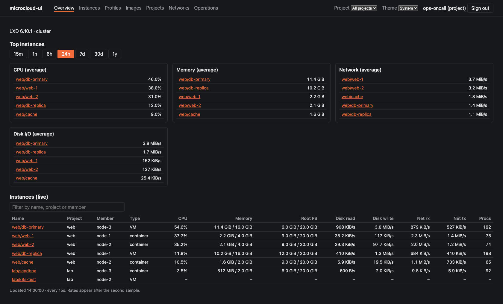
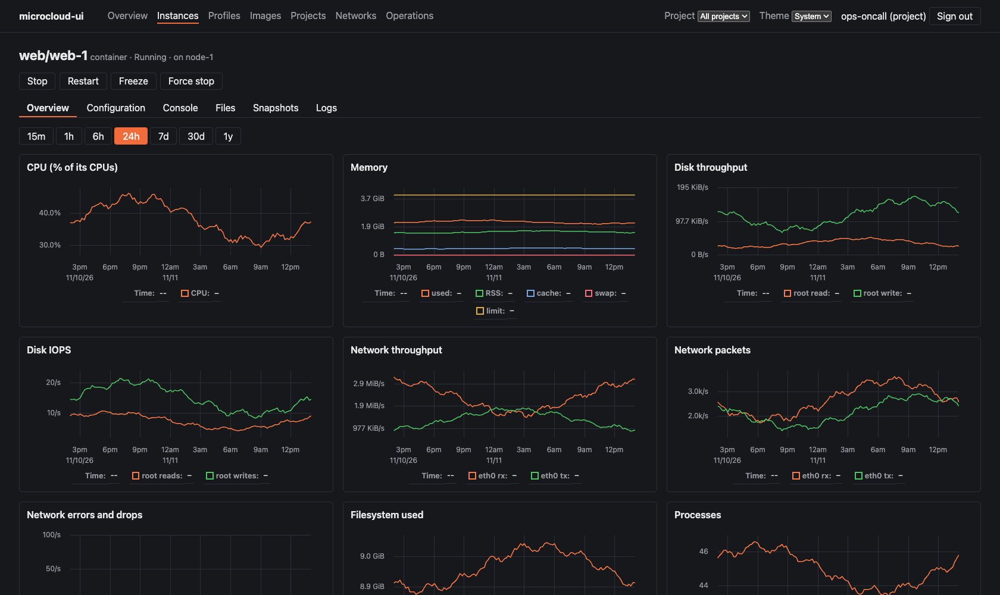
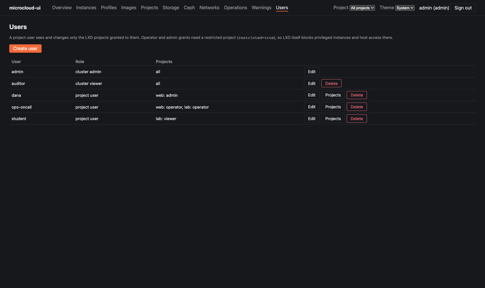

# Users and project access

microcloud-ui has its own users (stored in the config's `data_dir`). Since 0.2.0 a user
can be limited to some LXD projects, with a role in each (D81, Phase 6). The app still
talks to LXD as one admin; it decides what each user may see and do, and LXD's project
restrictions guard the host.

## Roles

Every user has one of three roles:

| Role | Sees | Changes |
|---|---|---|
| **Cluster admin** | everything | everything, including users, projects, members, storage pools and cluster settings |
| **Cluster viewer** | everything, including the audit log | nothing |
| **Project user** | only the projects granted to them | according to their role in each project |

A project user has a **grant** per project:

| Project role | Can |
|---|---|
| **viewer** | see the project's instances, volumes, networks, profiles, images and placement groups; their graphs; its operations and audit entries |
| **operator** | viewer, plus start, stop, restart, freeze; consoles and the terminal; files; instance and volume snapshots |
| **admin** | operator, plus create, change, rename, copy, move, publish and delete instances, and manage the project's own profiles, volumes, images, networks, ACLs, forwards, load balancers and placement groups, within its limits |

Files and consoles need operator because they can expose secrets.

## Preparing a project

**Operator and admin grants need a restricted project** (`restricted=true`). The app
refuses them otherwise. A restricted project makes LXD itself refuse privileged
containers, disks from host paths, `raw.lxc`, nesting, unix devices and similar, even
from the app's admin connection, when an instance or a profile is created or changed.
Checked on LXD 6.10 on 2026-11-13. Without it, an operator or admin of the project could
reach the host. Viewer grants work on any project.

Create a project for users from **Projects → Create project** with **Restricted**
ticked, or with `lxc`:

```
lxc project create web -c restricted=true -c features.storage.volumes=true
```

Keep **own storage volumes** (`features.storage.volumes=true`, LXD's default for new
projects). LXD answers queries on a project without them with `default`'s volumes, so
project users would see those. A project without its own networks, profiles or images
shares `default`'s: project users can see them and use them when creating an instance,
but not change them.

The project's own settings, `restricted` included, can only be changed by a cluster
admin. If someone unsets `restricted` behind the app's back (with `lxc`), operators and
admins of that project become read-only until it's set again. The app re-checks every 30
seconds.

LXD's other restriction keys (`restricted.devices.*`, `restricted.cluster.target`,
`restricted.networks.*` and so on) apply as usual. With the defaults, a project user
can't, for example, choose which member an instance runs on.

## What a project user sees

`ops-oncall`, an operator in `web` and `lab`, on the invented demo cluster:





- **Menu:** Overview, Instances, Profiles, Images, Projects, Networks and Operations. No
  Storage, Ceph, Warnings or Users.
- **Project picker:** only their projects. "All projects" means all of theirs.
- **Overview:** their instances only, with no hosts or members table.
- **Instance pages:** actions and tabs by their role. A viewer gets no Console or Files
  tab, an operator no Rename, Copy, Move, Publish or Delete.
- **Lists:** instances, operations, network allocations, DHCP leases, metrics, the audit
  log and the live event stream all keep to their projects.
- **Anything else** answers "not found", so it doesn't reveal what exists.

## Managing users



**In the UI:** **Users** (cluster admins only): create users and choose their role; edit
the role or reset the password (which signs them out); **Projects** to grant or remove a
project for a project user; delete users.

**From the command line** (on the server, as the service user):

```
mcui user add pat --role project      # admin, viewer or project; prompts for a password
mcui user grant pat web operator      # viewer, operator or admin
mcui user revoke pat web
mcui user list                        # role and grants
mcui user passwd pat
mcui user delete pat
```

`mcui user grant` asks LXD whether the project is restricted, so it needs the `[lxd]`
section of the config.

**Through the API** (cluster admins; with the session's CSRF token):

| Request | Does |
|---|---|
| `GET /api/users` | users, their role and grants |
| `POST /api/users` | `{"username", "password", "role"}` |
| `PATCH /api/users/{user}` | `{"role"}` and/or `{"password"}` |
| `PUT /api/users/{user}/grants/{project}` | `{"role": "viewer" \| "operator" \| "admin"}` |
| `DELETE /api/users/{user}/grants/{project}` | removes the grant |
| `DELETE /api/users/{user}` | deletes the user |

Every change is in the audit log (`user.create`, `user.grant`, `user.revoke` and so on).

## How it's enforced

- **One check in the backend** (`mcui/auth/policy.py`, `mcui/api/deps.py`) decides every
  request. Every API route declares one access policy: project read, operate or manage;
  cluster read or admin; or a filtered list. A test fails if a route has none
  (`backend/tests/test_policy.py`).
- **Lists are filtered on the server,** never in the browser.
- **A metrics query by a project user must name one of their projects,** because a sum
  across series would mix projects.
- **LXD's operations and network allocations don't carry a project field.** Their
  project is read from the object's URL (`mcui/lxd/entities.py`).
- **The UI only stops offering what the server would refuse** (`frontend/src/access.ts`).
- **LXD's `restricted=true` is the second line:** whatever the app sends, LXD keeps
  project users' instances away from the host.

## Upgrading to 0.2.0

The user store is migrated automatically the first time 0.2.0 starts: existing `admin`
and `viewer` users become cluster admins and cluster viewers, so nothing changes for them.
Two things do change:
- **Files and the console log** now need operate, so cluster viewers no longer see an
  instance's Console and Files tabs.
- **Grants in a backup:** a backup of `data_dir` taken before the upgrade lacks the new
  grants table, which is recreated empty if restored.

Not yet (later phases): OIDC or other sign-in providers, groups, users managed by project
admins, and per-user LXD identities.
