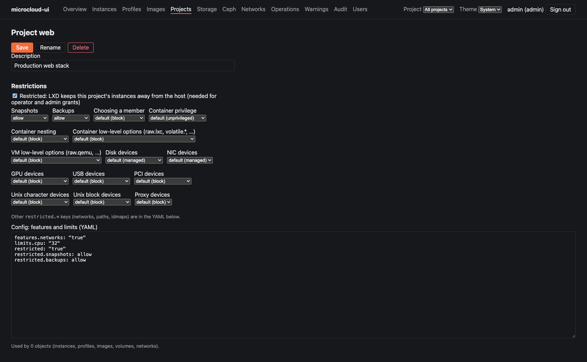
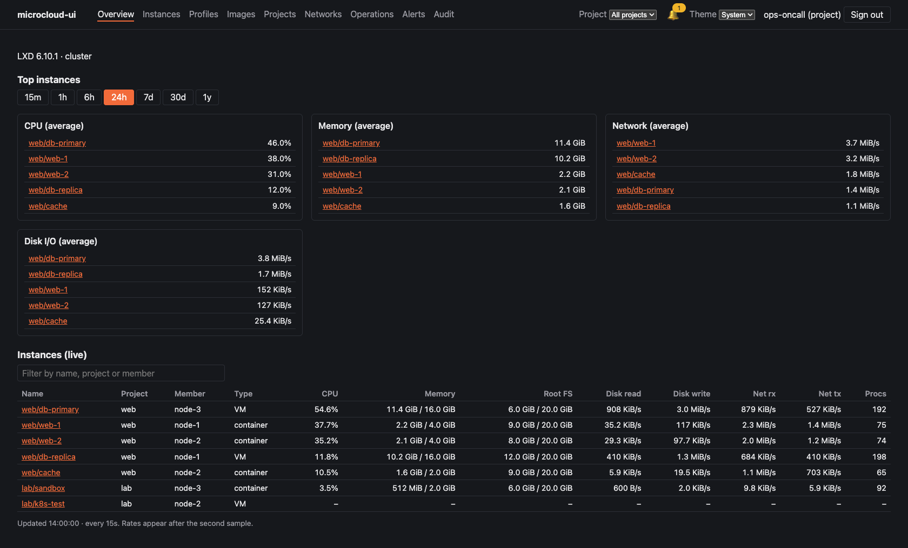
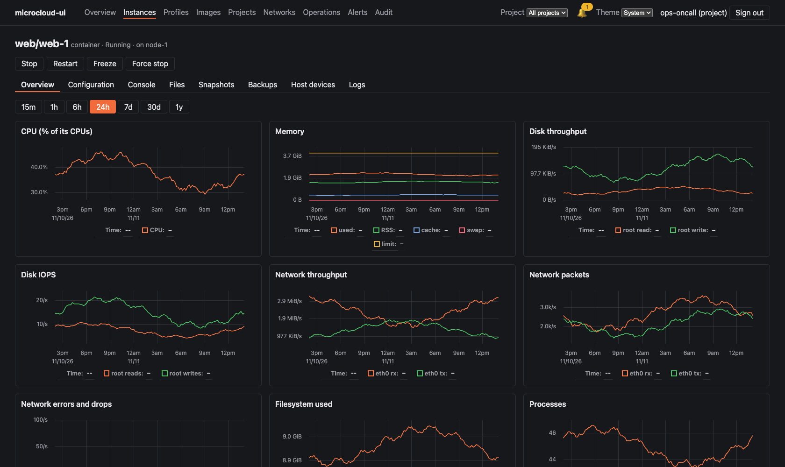
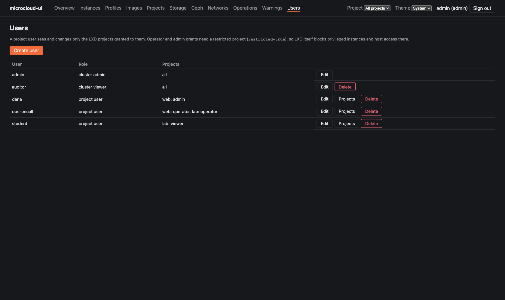
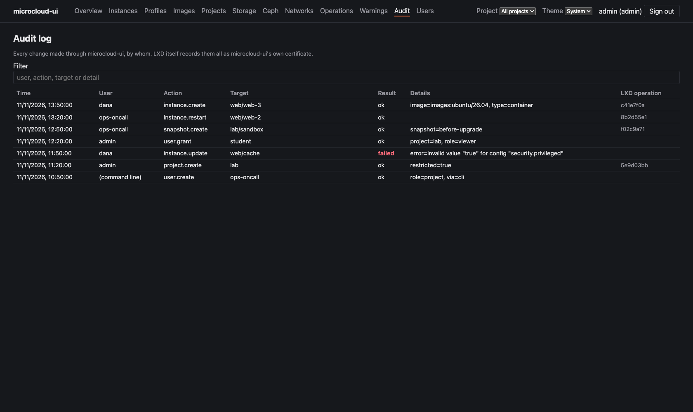

# Users and project access

microcloud-ui has its own users (stored in the config's `data_dir`). Since 0.2.0 a user
can be limited to some LXD projects, with a role in each (D81, Phase 6). The app still
talks to LXD as one admin; it decides what each user may see and do, and LXD's project
restrictions guard the host.

## Read this before deploying: one admin connection to LXD

microcloud-ui talks to LXD with **one certificate that has full admin rights over the
whole cluster**. Every user's action, whoever they are, reaches LXD as that certificate.
LXD never learns who the person is, so it can't apply its own access control to them.

So for its users, **microcloud-ui re-implements part of LXD's security model itself**:
who may see and do what in which project. It does not use LXD's own fine-grained
authorization (identities, groups, OIDC). What follows from that:

- **The app is the boundary between users.** A project user is kept out of other
  projects by microcloud-ui's checks alone, not by LXD. A bug in those checks could let
  them see or change another project. Every API route declares a policy, and the tests
  and live checks (`docs/LIVE-TESTS.md` P1–P6) exist because of this.
- **LXD still guards the host, but only in restricted projects.** In a
  `restricted=true` project, LXD refuses privileged instances, host disks and similar
  even from the admin connection. That's why operator and admin grants need one.
  Restrictions don't separate projects from each other, though; only the app does that.
- **Whoever controls microcloud-ui controls the cluster.** The server's certificate and
  key, its config and its data directory are as sensitive as LXD's own admin access.
  Anyone with a shell on the machine running it, or with a cluster admin account in it,
  can do anything to the cluster. Run it on a trusted machine, as the hardened service
  the bundle installs (`docs/DEPLOY.md`), behind HTTPS, and don't expose it to untrusted
  networks.
- **LXD's own logs show the certificate, not the person.** LXD's events and operations
  credit every change to microcloud-ui. Who actually did it is only in microcloud-ui's
  audit log (the **Audit** page).
- **Users live in microcloud-ui, not in LXD.** Its users, passwords and grants are in its
  own database. Disabling someone in LXD, or in an identity provider, doesn't affect them
  here, and the other way round.

Using LXD's own identities, so LXD enforces each user's rights itself (for example
through OIDC), would remove most of this. It's planned for a later phase (AU-4, AC-2).
Until then, treat microcloud-ui as an admin tool that can safely *delegate* parts of
LXD to other people, not as a substitute for LXD's own access control.

## Roles

Every user has one of three roles:

| Role | Sees | Changes |
|---|---|---|
| **Cluster admin** | everything | everything, including users, projects, members, storage pools and cluster settings |
| **Cluster viewer** | everything, including the audit log | nothing |
| **Project user** | only the projects granted to them | according to their role in each project |

A project user has a **grant** per project:

| Project role | Can |
|---|---|
| **viewer** | see the project's instances, volumes, networks, profiles, images and placement groups; their graphs; its operations and audit entries |
| **operator** | viewer, plus start, stop, restart, freeze; consoles and the terminal; files; instance and volume snapshots; instance and volume backups (make, rename, delete, download) |
| **admin** | operator, plus create, change, rename, copy, move (to another project only if admin there too), publish and delete instances, import volume backups, copy and move volumes (to another project only if admin there too), upload ISOs and attach them, and manage the project's own profiles, volumes, images, networks, ACLs, forwards, load balancers and placement groups, within its limits |

Files, consoles and backup downloads need operator because they can expose secrets.

**Instance backups are imported by cluster admins only** (0.3.4). A backup names its own
devices, which the app can't check as the file streams through, so a project admin could
otherwise bring in host paths or USB devices. LXD 6.10 refuses imports into restricted
projects anyway; the way round is below (import, then move).

### The host-devices right

Host paths and USB devices (and the other device types that reach a member's hardware:
PCI, GPU, unix devices) are for **cluster admins only**, by default. A cluster admin can
give a project's **admin** the **host-devices** right too:
- in the app: **Users → Projects**, then **Allow host devices** on an admin grant, or
  **Also host paths and USB devices** when granting;
- with the CLI: `mcui user grant pat web admin --host-devices`.

It's per project, and only on admin grants. Granting the project again without it, or
with another role, takes it away. **Withdraw host devices** does the same.

With the right, a project admin can add and remove host paths and USB devices on the
project's instances ([how](WORKFLOWS.md#attach-host-paths-and-usb-devices)). Without
it, the app refuses adding or changing any such device, whether through the **Host
devices** tab, the YAML editor, the create wizard or a profile. They may still edit an
instance that keeps the host devices a cluster admin gave it, and may remove them from
its configuration. The same check covers what arrives from elsewhere (0.3.4): copying an
instance, moving one into another project, and restoring a snapshot that brings back a
device removed since. "Host devices" means USB, PCI, GPU, unix, InfiniBand and proxy
devices, NICs on a host interface (not a managed network), and disks that aren't pool
volumes: host paths and Ceph sources (`ceph:`/`cephfs:`, which could name any RBD image or
CephFS share in the cluster). Checked live on LXD 6.10.1 on 2026-11-27.

**LXD still has to allow them in the project.** The right is the app's check; the
project's restrictions are LXD's, and both apply:
- host paths: `restricted.devices.disk=allow`, and set `restricted.devices.disk.paths`
  to the folders you mean (for example `/srv/nfs`). Without allowed paths, any host path
  can be mounted, and a shifted mount of `/` gives root on the host. The Restrictions form
  has a field for it.
- USB devices: `restricted.devices.usb=allow`.

**Hidden folders (the app's check):** a project admin with the right still can't see or
attach anything in the folders a cluster admin hides, nor a folder that contains one (`/`,
`/var`; 0.3.4), under **Settings** (or
`[host_devices] hidden_paths`). The built-in list covers personal files, host config,
snap state with LXD's, MicroCeph's and MicroOVN's keys, `/run` with the LXD socket, logs,
and kernel and device folders. It's checked on the path as typed, so treat
`restricted.devices.disk.paths` as the real boundary; the hidden list catches mistakes and
keeps the folder browser away from private places.

So the safe pattern for, say, an NFS share every member mounts: allow disks with the
share's folder as the only allowed path, then give that project's admins the right.
Anyone with the right can attach any USB device a member has, so allow USB only where
you trust the project's admins with the hardware.

## Preparing a project

**Operator and admin grants need a restricted project** (`restricted=true`). The app
refuses them otherwise. A restricted project makes LXD itself refuse privileged
containers, disks from host paths, `raw.lxc`, nesting, unix devices and similar, even
from the app's admin connection, when an instance or a profile is created or changed.
Checked on LXD 6.10 on 2026-11-13. Without it, an operator or admin of the project could
reach the host. Viewer grants work on any project.

Create a project for users from **Projects → Create project** with **Restricted**
ticked, or with `lxc`:

```
lxc project create web -c restricted=true -c features.storage.volumes=true
```

**Allow snapshots and backups if operators should make them.** A restricted project
refuses both by default, even from the app, until `restricted.snapshots=allow` and
`restricted.backups=allow` are set. Checked on LXD 6.10 on 2026-11-13. Set them with
`lxc project set web restricted.snapshots=allow restricted.backups=allow`, or on the
project's page under **Restrictions**. **Create project** allows both when Restricted is
ticked, unless you untick it.



**The Restrictions form** on a project's page sets LXD's `restricted.*` keys; "default"
leaves a key unset, which means LXD's default. Choices marked "reaches the host" (low-level
options, privileged containers, host disks, unix, USB, PCI and GPU devices, nesting) undo
what operator and admin grants rely on, and the page says so. With Disk devices allowed,
the form also asks for the **allowed host paths**. For disk, USB, PCI, GPU and unix
devices, the app additionally limits them to cluster admins and admins with the
[host-devices right](#the-host-devices-right). Other keys (networks, idmaps) are in the
YAML editor.

**Importing a backup into a restricted project doesn't work** on LXD 6.10.1 (checked
2026-11-13). LXD counts the backup's own `volatile.*` keys as low-level options and
refuses them in any project with `restricted` or `limits.*` set. Only
`restricted.containers.lowlevel=allow` lets the import through. Don't set that on a
restricted project: it also lets the project's users set `raw.lxc` and similar, which
reach the host. LXD still refused a backup edited to be privileged, with low-level
options allowed (CVE-2026-34178, fixed in 6.8, was a bypass of exactly that check). The
import dialog warns when a project is affected.

**The way round:** a cluster admin imports the backup into an unrestricted project without
`limits.*` (one kept for the purpose, for example), then moves the instance into the
restricted project (**Move** → To project, with it stopped). The move checks the target's
restrictions without the `volatile.*` keys, and still refuses a privileged instance.
Checked on LXD 6.10.1 on 2026-11-13.

**Moving between projects:** a project admin can move a stopped instance to another
project where they're also an admin. Its snapshots go with it only if the target allows
snapshots; otherwise leave them behind, which deletes them with the original. Volume backups aren't affected: they
import into a restricted project.

Keep **own storage volumes** (`features.storage.volumes=true`, LXD's default for new
projects). LXD answers queries on a project without them with `default`'s volumes, so
project users would see those. A project without its own networks, profiles or images
shares `default`'s: project users can see them and use them when creating an instance,
but not change them. The app refuses their writes there (0.3.5): without the feature, LXD
would apply a project's profile change to `default`'s profile and check restrictions
against `default`, which has none. Give projects for users their own profiles, images
and volumes (`features.profiles`, `features.images`, `features.storage.volumes`, LXD's
defaults for new projects).

The project's own settings, `restricted` included, can only be changed by a cluster
admin. If someone unsets `restricted` behind the app's back (with `lxc`), operators and
admins of that project become read-only until it's set again. The app re-checks every 30
seconds.

LXD's other restriction keys (`restricted.devices.*`, `restricted.cluster.target`,
`restricted.networks.*` and so on) apply as usual. With the defaults, a project user
can't, for example, choose which member an instance runs on.

## Sign-in and sessions

- **Failed sign-ins are throttled** (0.3.5): after 5 failures for a username, or 30 from
  one address, within 5 minutes, sign-in answers "too many failed sign-ins" (HTTP 429)
  until the oldest failure is 5 minutes old. A success clears that username's count. The
  count is in memory, so a restart clears it. Behind a reverse proxy, set
  `forwarded_allow_ips` so the address is the client's, not the proxy's.
- **Failed sign-ins with an unknown username are audited without it**: people sometimes
  type a password there.
- **Open connections follow access changes** (0.3.5): a terminal or console re-checks the
  operate right when (re)attached and belongs to the login session that started it, so it
  ends with a logout, a removed grant or a deleted user. The live event stream re-reads
  its session every 30 seconds.
- **Grants go with their project**: renaming a project moves its grants, deleting it
  removes them, so a later project with the old name starts with none.

## What a project user sees

`ops-oncall`, an operator in `web` and `lab`, on the invented demo cluster:





- **Menu:** Overview, Instances, Profiles, Images, Projects, Networks and Operations. No
  Storage, Ceph, Warnings or Users.
- **Project picker:** only their projects. "All projects" means all of theirs.
- **Overview:** their instances only, with no hosts or members table.
- **Instance pages:** actions and tabs by their role. A viewer gets no Console or Files
  tab, an operator no Rename, Copy, Move, Publish or Delete.
- **Lists:** instances, operations, network allocations, DHCP leases, metrics, the audit
  log and the live event stream all keep to their projects.
- **Anything else** answers "not found", so it doesn't reveal what exists.

## Managing users



**The audit log:** the **Audit** page lists every change and who made it, with LXD's
operation for each. Cluster admins and viewers see everything; a project user sees their
projects' changes.



**In the UI:** **Users** (cluster admins only): create users and choose their role; edit
the role or reset the password (which signs them out); **Projects** to grant or remove a
project for a project user; delete users.

**From the command line** (on the server, as the service user):

```
mcui user add pat --role project      # admin, viewer or project; prompts for a password
mcui user grant pat web operator      # viewer, operator or admin
mcui user revoke pat web
mcui user list                        # role and grants
mcui user passwd pat
mcui user delete pat
```

`mcui user grant` asks LXD whether the project is restricted, so it needs the `[lxd]`
section of the config.

**Through the API** (cluster admins; with the session's CSRF token):

| Request | Does |
|---|---|
| `GET /api/users` | users, their role and grants |
| `POST /api/users` | `{"username", "password", "role"}` |
| `PATCH /api/users/{user}` | `{"role"}` and/or `{"password"}` |
| `PUT /api/users/{user}/grants/{project}` | `{"role": "viewer" \| "operator" \| "admin"}` |
| `DELETE /api/users/{user}/grants/{project}` | removes the grant |
| `DELETE /api/users/{user}` | deletes the user |

Every change is in the audit log (`user.create`, `user.grant`, `user.revoke` and so on).

## How it's enforced

- **One check in the backend** (`mcui/auth/policy.py`, `mcui/api/deps.py`) decides every
  request. Every API route declares one access policy: project read, operate or manage;
  cluster read or admin; or a filtered list. A test fails if a route has none
  (`backend/tests/test_policy.py`).
- **Lists are filtered on the server,** never in the browser.
- **A metrics query by a project user must name one of their projects,** because a sum
  across series would mix projects.
- **LXD's operations and network allocations don't carry a project field.** Their
  project is read from the object's URL (`mcui/lxd/entities.py`).
- **The UI only stops offering what the server would refuse** (`frontend/src/access.ts`).
- **LXD's `restricted=true` is the second line:** whatever the app sends, LXD keeps
  project users' instances away from the host.

## Upgrading to 0.2.0

The user store is migrated automatically the first time 0.2.0 starts: existing `admin`
and `viewer` users become cluster admins and cluster viewers, so nothing changes for them.
Two things do change:
- **Files and the console log** now need operate, so cluster viewers no longer see an
  instance's Console and Files tabs.
- **Grants in a backup:** a backup of `data_dir` taken before the upgrade lacks the new
  grants table, which is recreated empty if restored.

Not yet (later phases): OIDC or other sign-in providers, groups, users managed by project
admins, and per-user LXD identities.
