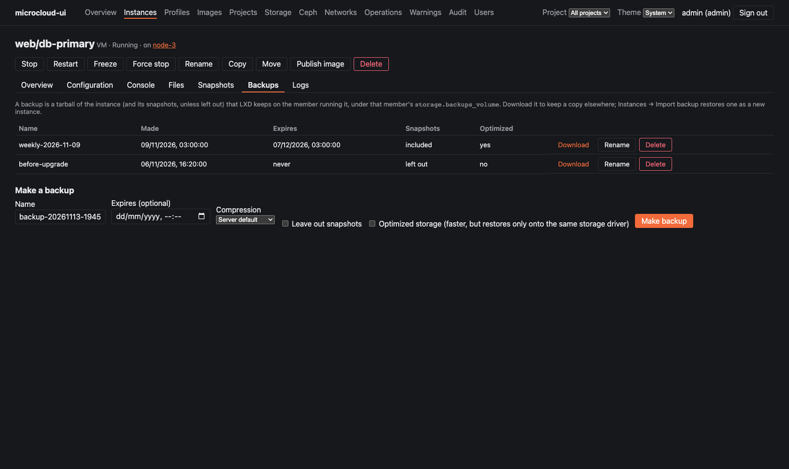
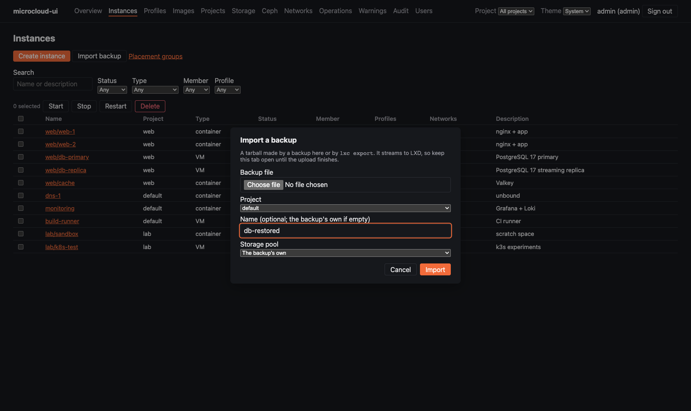
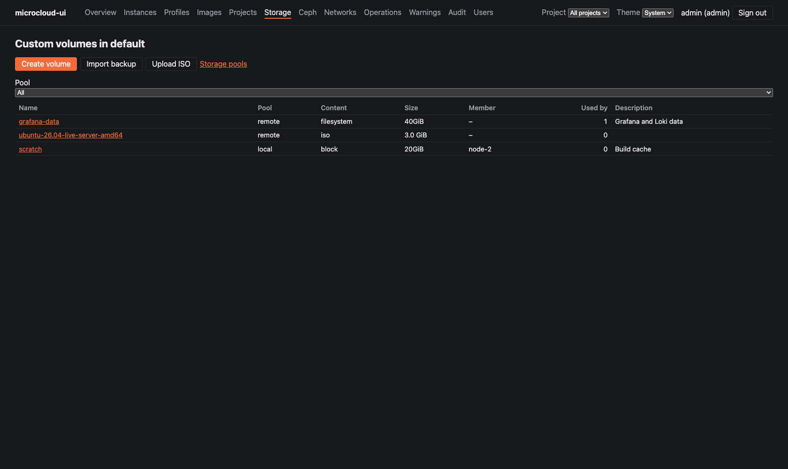
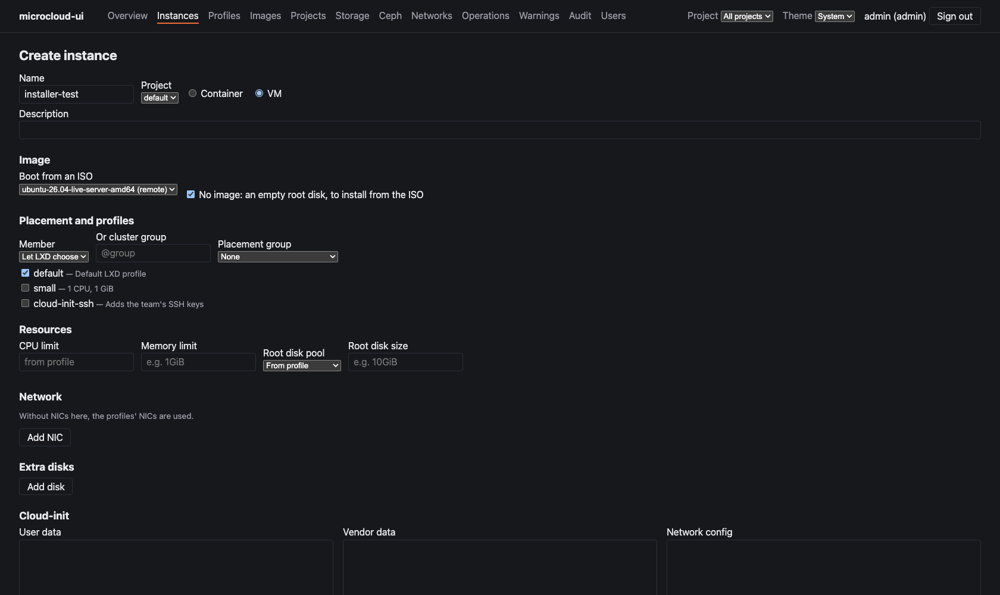
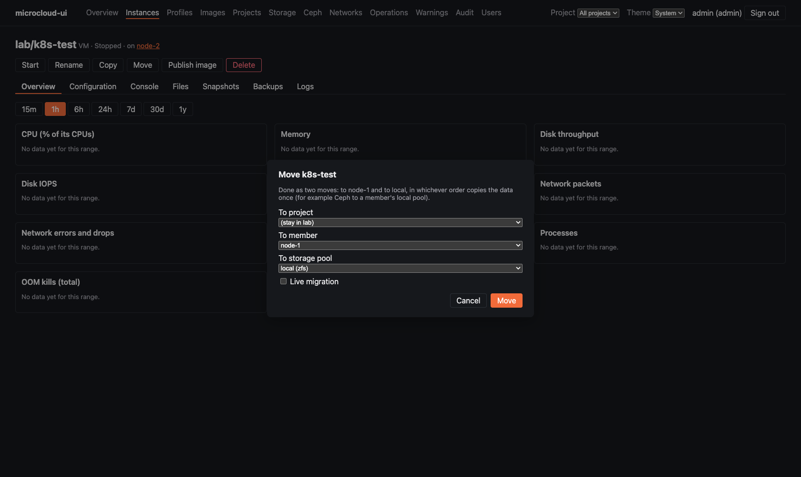
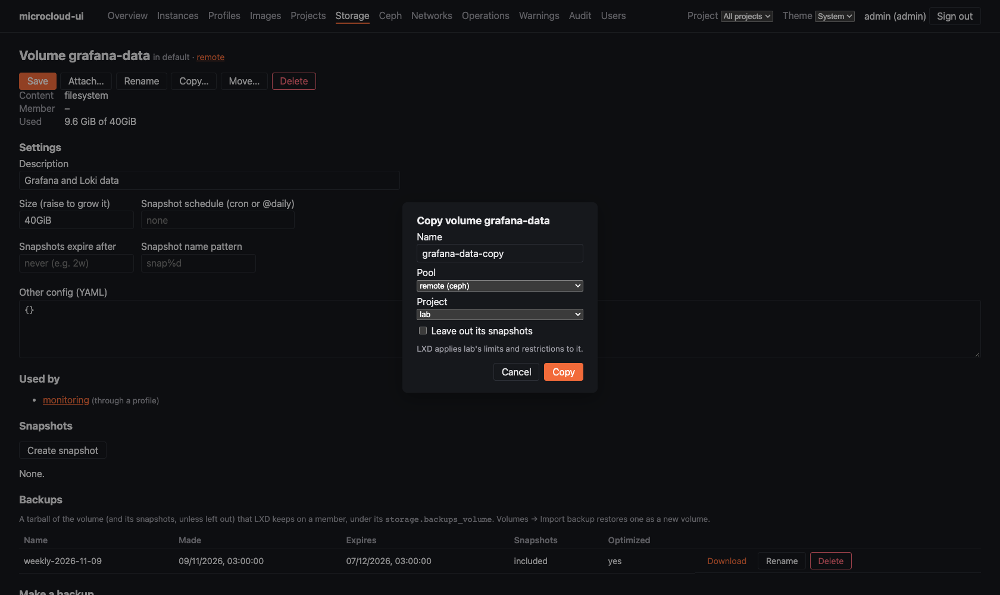
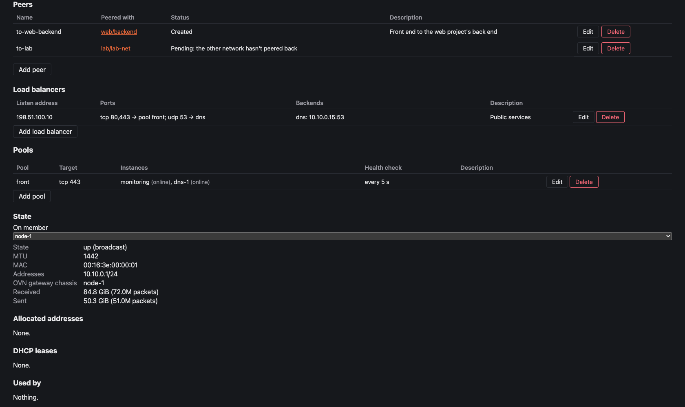
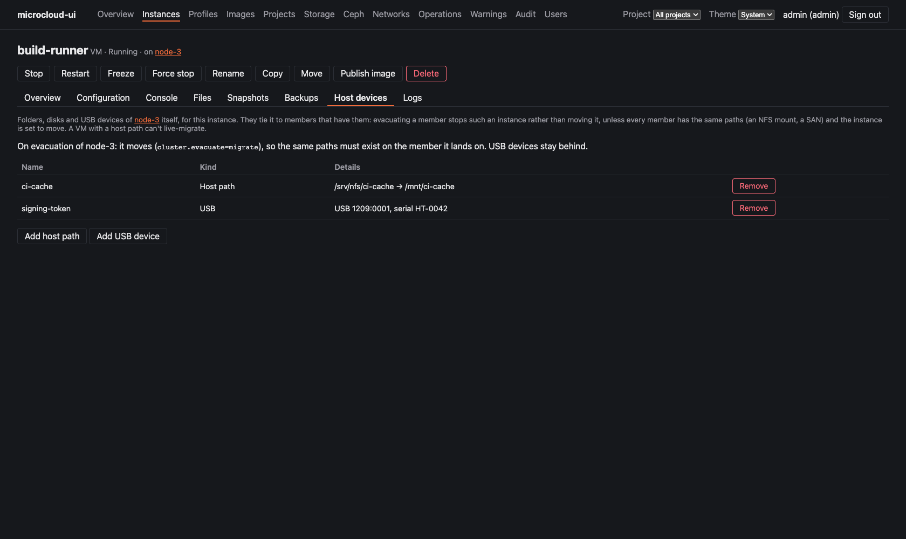
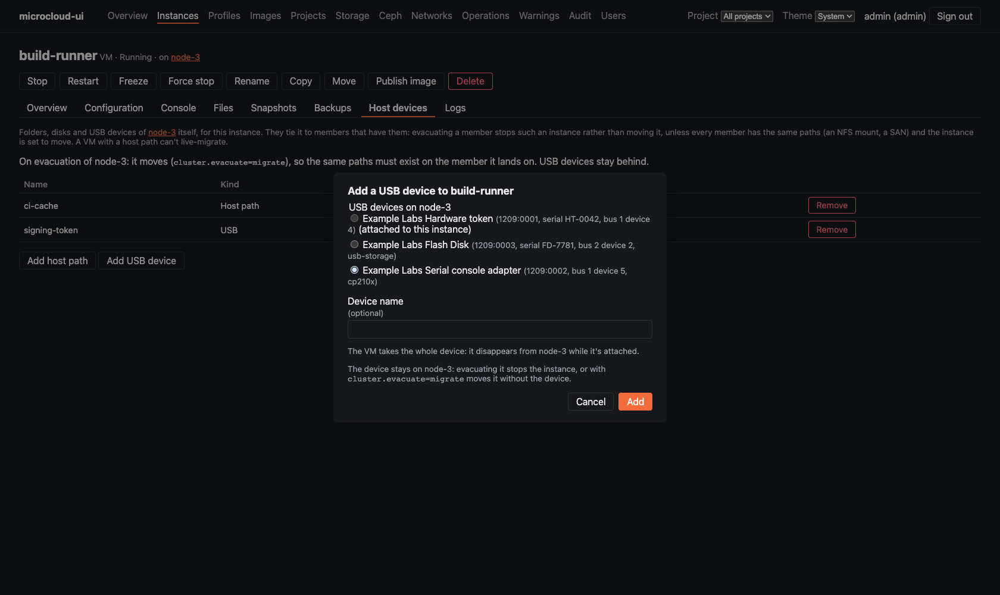
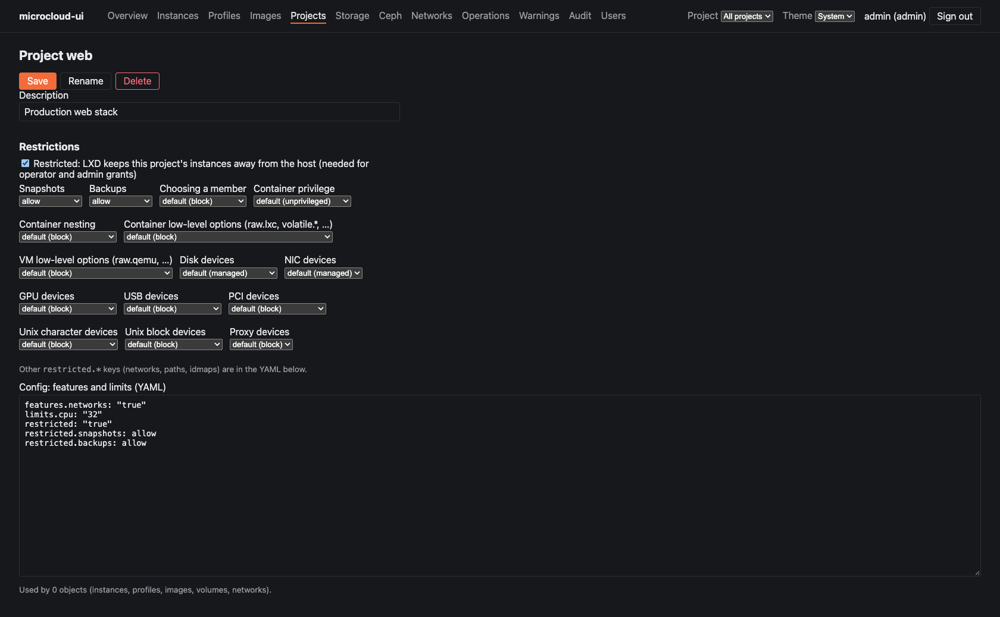

# Workflows

How to do the common jobs in microcloud-ui: backups, installing from an ISO, moving
instances (between members, between Ceph and local storage, between projects), copying
and moving volumes, peering OVN networks, and attaching a member's own folders, disks and
USB devices to an instance.

Each section says who may do it (see [`USERS.md`](USERS.md) for the roles) and what LXD
itself insists on. Everything here was checked on LXD 6.10 (MicroCloud 3.4); the
screenshots come from the invented demo cluster.

## Back up and restore an instance

**Who:** a project operator or above makes, downloads, renames and deletes backups; a
project admin imports them.

1. Open the instance and its **Backups** tab.
2. Under **Make a backup**, choose:
   - **Name**: a dated one is filled in.
   - **Expires**: optional. LXD deletes the backup then.
   - **Compression**: the server's default unless you pick one. zstd is the fastest.
   - **Leave out snapshots**: only the instance as it is now.
   - **Optimized storage**: faster, but restores only onto the same storage driver.
3. **Download** saves the tarball, named after the instance, the backup and its
   compression (`db-primary-weekly.tar.zst`). Keep a copy off the cluster: LXD keeps
   backups on the member running the instance, under its `storage.backups_volume`, by
   default its root disk.

**Restore** from **Instances → Import backup**: choose the file, the project, optionally a
new name and a pool. The upload streams to LXD, with its progress in the action's
message, so keep the tab open until it finishes.

**What LXD insists on:**
- **Restricted projects refuse backups** until `restricted.backups=allow` is set (project
  page → **Restrictions** → Backups). Snapshots likewise need `restricted.snapshots=allow`.
- **Importing into a project with limits or restrictions is refused.** LXD counts the
  backup's own `volatile.*` keys as low-level options. The dialog warns about this. The
  way round: import into an unrestricted project without `limits.*`, then
  [move the instance](#move-an-instance) across, stopped. LXD checks it against the
  target's restrictions there, so a privileged instance is still refused.

## Install a VM from an ISO

**Who:** a project admin.

1. **Storage → Volumes → Upload ISO**: choose the ISO file and a pool. The volume is named
   after the file unless you give a name, and lists with content type `iso`.

   

2. **Create instance**, choose **VM**, then under **Image**:
   - **Boot from an ISO**: the ISO volume.
   - **No image**: an empty root disk to install onto. Set **Root disk size** under
     Resources.

   

3. Start the VM and open its **Console** tab (graphical) to run the installer.
4. Afterwards, detach the ISO from the volume's page (**Used by → Detach**), or keep it.

**To an existing VM:** open the ISO volume and choose **Attach…**. Only VMs are offered.
**Boot from it first** sets its `boot.priority`. The VM sees it after a restart.

## Move an instance

**Who:** a project admin. To another project, an admin of both projects.

Open the instance and choose **Move**:

- **To member**: on Ceph this only relinks the instance, so it's quick. On a local pool
  LXD copies it across.
- **To storage pool**: between Ceph and a local pool (zfs, lvm, btrfs, dir), either way.
  The instance must be stopped; the dialog won't send it otherwise.
- **Member and pool together**, for example "Ceph to node-1's local pool": the app makes
  two moves in the order that copies the data once. From Ceph it moves to the member
  first and then copies to its local pool. From a local pool it copies to the new pool
  first and then moves. (LXD, given both at once, would move it to the member and ignore
  the pool.)
- **To project**: the instance must be stopped. LXD applies the target project's limits
  and restrictions. Its snapshots go with it only if the target allows snapshots;
  otherwise tick **Leave its snapshots behind**, which deletes them with the original.
  Its volumes stay where they are, and its profiles and networks must exist there too.
- **Live migration** (VMs on Ceph, between members) keeps the VM running.

The instance keeps its data and snapshots across members and pools (checked with
containers on a two-member cluster with Ceph and local ZFS pools). VMs on local pools
weren't tested.

## Back up, copy and move volumes

**Who:** a project operator or above for backups; a project admin to copy, move or
import. To or from another project, an admin of both.

Open the volume (**Storage → Volumes**):
- **Backups**: as for instances. Restore from **Volumes → Import backup**. Volume imports
  aren't affected by the restricted-project refusal above.
- **Copy…**: to any pool or project, under a new name. On a local pool you can choose
  the member. **Leave out its snapshots** copies the volume only.
- **Move…**: to another pool or project, renaming it on the way if you like. A volume in
  use moves too, even with its instance running: LXD points the instance's device at its
  new place.

## Peer OVN networks

**Who:** a project admin of the network's project. The other network's project must be
one you can see.

Peered OVN networks on the same uplink route to each other directly. Open an OVN network
and use **Peers → Add peer**:

- Choose the other project and network, and a name (`to-<network>` if empty).
- A peer is **Pending** until the other network peers back. Tick **Also peer back** (shown
  when you can manage the other project) to do both sides at once.
- **Delete** stops the routing. The other side's peer stays until it's deleted there too.

## Attach host paths and USB devices

**Who:** a cluster admin, or a project admin whose grant carries the **host-devices** right
(a cluster admin gives it under **Users → Projects**; see
[`USERS.md`](USERS.md#the-host-devices-right)). Everyone who can see the instance sees
the list.

These give an instance something on the member it runs on: a folder (say an NFS mount or
a SAN that every member has), a single disk, or a USB device. Open the instance and its
**Host devices** tab. It lists the instance's host devices and those from its profiles, and
says what evacuating its member would do with it.

**Add host path:**
- **Path on the member**: a folder, a file, or a block device such as
  `/dev/disk/by-id/…`. The app can't browse the member's files, so type it; LXD says if
  it doesn't exist. USB disks plugged into the member are offered from a list.
- **Path inside**: where it's mounted. A container needs one. A VM gets a folder through
  its agent at that path; leave it empty to give a VM a block device as a disk.
- **Read-only** is ticked by default. **Shift** (containers) maps file ownership so the
  container's users own their files.
- **Every member has this path** sets `cluster.evacuate=migrate` (below).

**Add USB device:** choose one from the member's live list. Devices already attached are
greyed out.
- A **VM** takes the whole device: it disappears from the member while attached. This is
  how to give a VM a USB disk, a dongle or a serial adapter.
- A **container** only gets the device's `/dev/bus/usb` node, for programs that use
  libusb. For a USB disk's files, add the disk as a host path instead: LXD mounts it.
- It's matched by vendor and product ID, plus its serial number when it has one. Two
  identical devices without serials are matched by where they're plugged in, which can
  change after a replug.

Both kinds are added and removed at once, even while the instance runs (checked on LXD
6.10 with a container). **Remove** takes the device away immediately.

**What it does to moves and evacuation:**
- **By default LXD stops the instance when its member is evacuated**, rather than moving
  it. With `cluster.evacuate` unset (auto), LXD only moves instances whose devices can all
  move, and host paths and USB devices can't.
- **If every member has the same paths** (an NFS mount, a SAN, the same folders), tick
  **Every member has this path** when adding it, or use **Move it instead** on the tab.
  That sets `cluster.evacuate=migrate`: LXD stops the instance, moves it and starts it on
  another member, where the paths must exist too.
- **USB devices never follow.** With `migrate`, the instance moves and starts without the
  device (LXD's USB devices aren't required to start).
- **A VM with a host path can't live-migrate.** LXD refuses `migration.stateful` on it.
- The **Move** dialog names the instance's host devices when you choose another member.

**What LXD insists on in a restricted project** (as every project with project users is):
- Host paths need `restricted.devices.disk=allow` (project page → **Restrictions** → Disk
  devices). Also set **Allowed host paths**, for example `/srv/nfs`. Without it any host
  path can be mounted, and a shifted mount of `/` gives root on the host.
- USB devices need `restricted.devices.usb=allow`.
- LXD refuses the device otherwise, even for a cluster admin, and the app shows its
  message (for example "Disk source path "/etc" not allowed").

## Restrict a project

**Who:** a cluster admin.

A project's page has a **Restrictions** form for LXD's `restricted.*` keys, with what
each choice means and a warning on those that reach the host. See
[`USERS.md`](USERS.md#preparing-a-project).

## Not available on MicroCloud

- **ACL logs:** LXD reads them from MicroOVN's chassis journal, which has no ACL entries
  on MicroCloud, so there's no log viewer.
- **SR-IOV networks:** not built yet (no hardware to test on).
