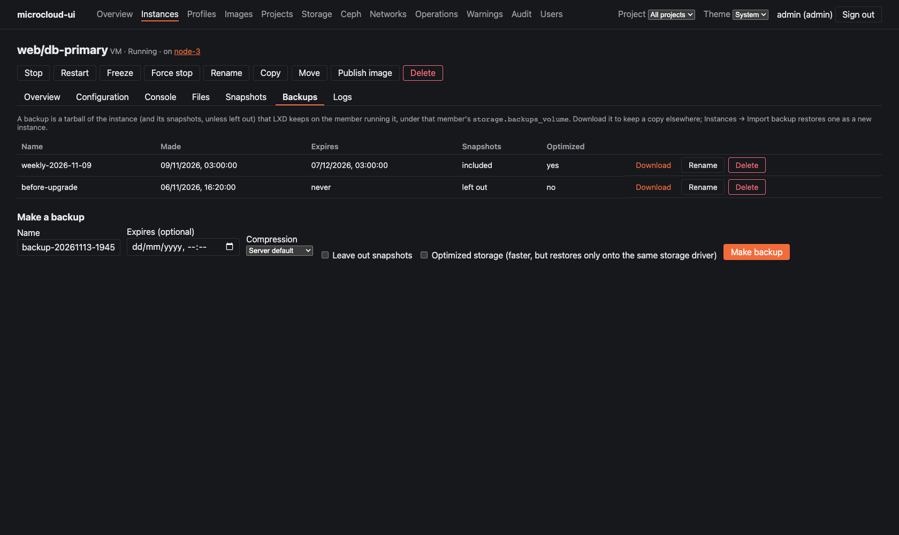
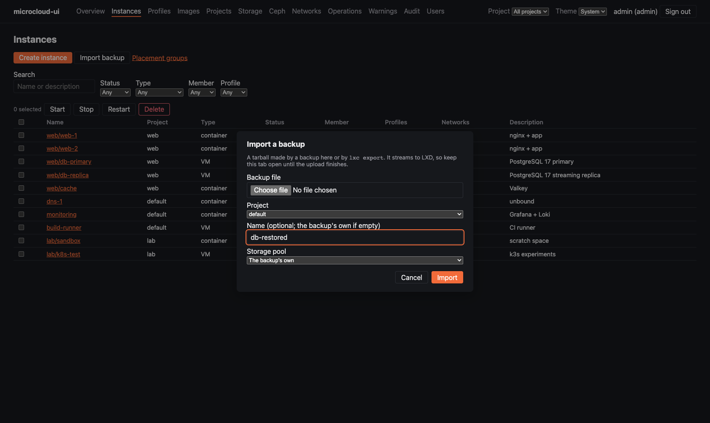
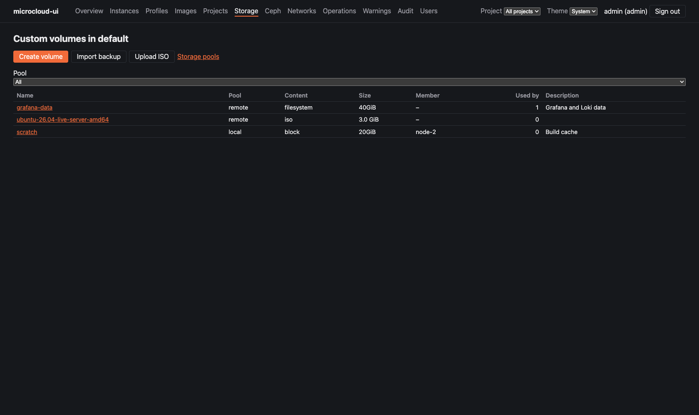
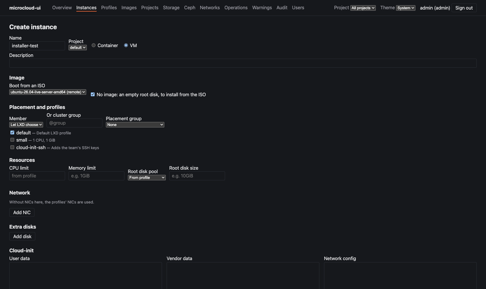
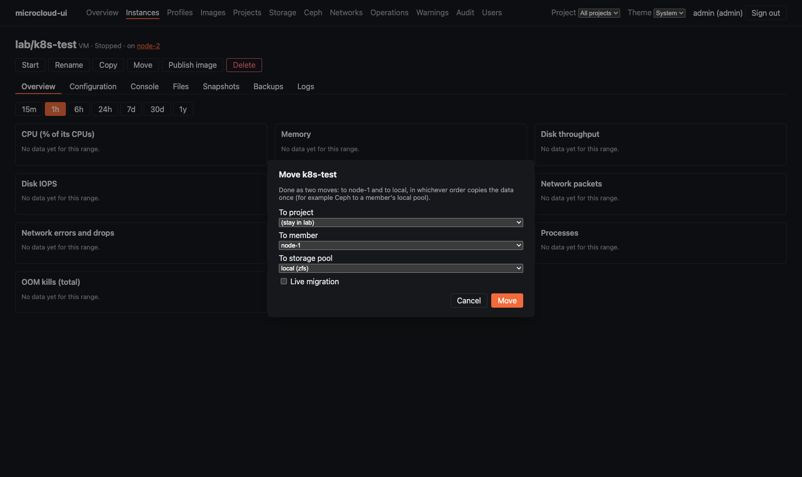
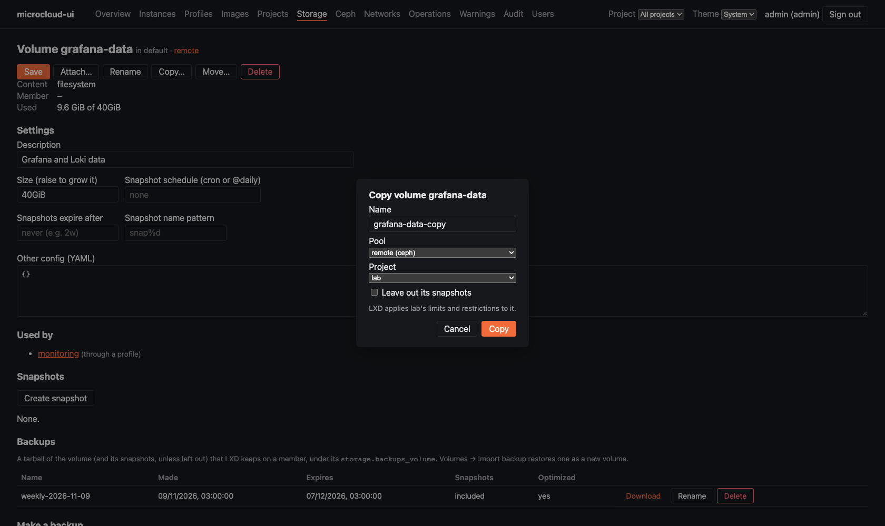
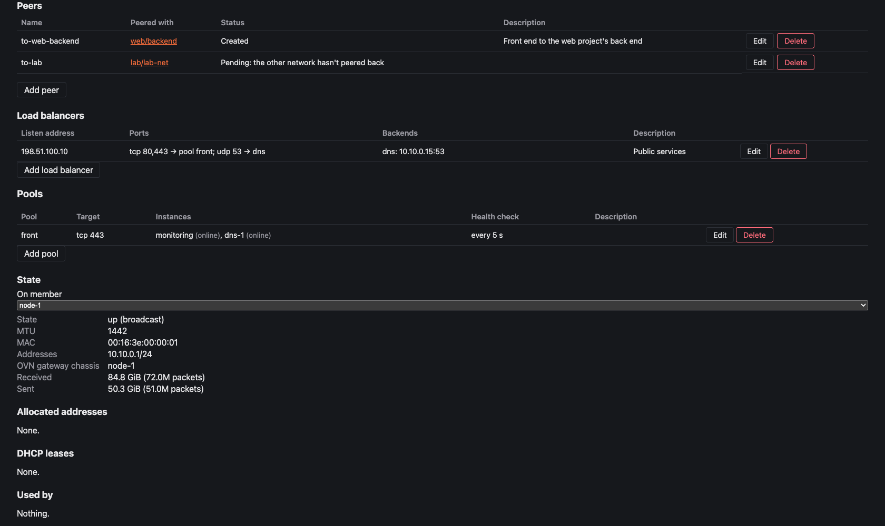
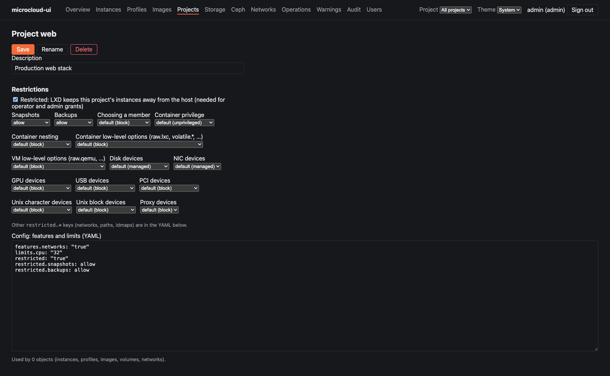

# Workflows

How to do the common jobs in microcloud-ui: backups, installing from an ISO, moving
instances (between members, between Ceph and local storage, between projects), copying
and moving volumes, and peering OVN networks.

Each section says who may do it (see [`USERS.md`](USERS.md) for the roles) and what LXD
itself insists on. Everything here was checked on LXD 6.10 (MicroCloud 3.4); the
screenshots come from the invented demo cluster.

## Back up and restore an instance

**Who:** a project operator or above makes, downloads, renames and deletes backups; a
project admin imports them.

1. Open the instance and its **Backups** tab.
2. Under **Make a backup**, choose:
   - **Name**: a dated one is filled in.
   - **Expires**: optional. LXD deletes the backup then.
   - **Compression**: the server's default unless you pick one. zstd is the fastest.
   - **Leave out snapshots**: only the instance as it is now.
   - **Optimized storage**: faster, but restores only onto the same storage driver.
3. **Download** saves the tarball, named after the instance, the backup and its
   compression (`db-primary-weekly.tar.zst`). Keep a copy off the cluster: LXD keeps
   backups on the member running the instance, under its `storage.backups_volume`, by
   default its root disk.

**Restore** from **Instances → Import backup**: choose the file, the project, optionally a
new name and a pool. The upload streams to LXD, with its progress in the action's
message, so keep the tab open until it finishes.

**What LXD insists on:**
- **Restricted projects refuse backups** until `restricted.backups=allow` is set (project
  page → **Restrictions** → Backups). Snapshots likewise need `restricted.snapshots=allow`.
- **Importing into a project with limits or restrictions is refused.** LXD counts the
  backup's own `volatile.*` keys as low-level options. The dialog warns about this. The
  way round: import into an unrestricted project without `limits.*`, then
  [move the instance](#move-an-instance) across, stopped. LXD checks it against the
  target's restrictions there, so a privileged instance is still refused.

## Install a VM from an ISO

**Who:** a project admin.

1. **Storage → Volumes → Upload ISO**: choose the ISO file and a pool. The volume is named
   after the file unless you give a name, and lists with content type `iso`.

   

2. **Create instance**, choose **VM**, then under **Image**:
   - **Boot from an ISO**: the ISO volume.
   - **No image**: an empty root disk to install onto. Set **Root disk size** under
     Resources.

   

3. Start the VM and open its **Console** tab (graphical) to run the installer.
4. Afterwards, detach the ISO from the volume's page (**Used by → Detach**), or keep it.

**To an existing VM:** open the ISO volume and choose **Attach…**. Only VMs are offered.
**Boot from it first** sets its `boot.priority`. The VM sees it after a restart.

## Move an instance

**Who:** a project admin. To another project, an admin of both projects.

Open the instance and choose **Move**:

- **To member**: on Ceph this only relinks the instance, so it's quick. On a local pool
  LXD copies it across.
- **To storage pool**: between Ceph and a local pool (zfs, lvm, btrfs, dir), either way.
  The instance must be stopped; the dialog won't send it otherwise.
- **Member and pool together**, for example "Ceph to node-1's local pool": the app makes
  two moves in the order that copies the data once. From Ceph it moves to the member
  first and then copies to its local pool. From a local pool it copies to the new pool
  first and then moves. (LXD, given both at once, would move it to the member and ignore
  the pool.)
- **To project**: the instance must be stopped. LXD applies the target project's limits
  and restrictions. Its snapshots go with it only if the target allows snapshots;
  otherwise tick **Leave its snapshots behind**, which deletes them with the original.
  Its volumes stay where they are, and its profiles and networks must exist there too.
- **Live migration** (VMs on Ceph, between members) keeps the VM running.

The instance keeps its data and snapshots across members and pools (checked with
containers on a two-member cluster with Ceph and local ZFS pools). VMs on local pools
weren't tested.

## Back up, copy and move volumes

**Who:** a project operator or above for backups; a project admin to copy, move or
import. To or from another project, an admin of both.

Open the volume (**Storage → Volumes**):
- **Backups**: as for instances. Restore from **Volumes → Import backup**. Volume imports
  aren't affected by the restricted-project refusal above.
- **Copy…**: to any pool or project, under a new name. On a local pool you can choose
  the member. **Leave out its snapshots** copies the volume only.
- **Move…**: to another pool or project, renaming it on the way if you like. A volume in
  use moves too, even with its instance running: LXD points the instance's device at its
  new place.

## Peer OVN networks

**Who:** a project admin of the network's project. The other network's project must be
one you can see.

Peered OVN networks on the same uplink route to each other directly. Open an OVN network
and use **Peers → Add peer**:

- Choose the other project and network, and a name (`to-<network>` if empty).
- A peer is **Pending** until the other network peers back. Tick **Also peer back** (shown
  when you can manage the other project) to do both sides at once.
- **Delete** stops the routing. The other side's peer stays until it's deleted there too.

## Restrict a project

**Who:** a cluster admin.

A project's page has a **Restrictions** form for LXD's `restricted.*` keys, with what
each choice means and a warning on those that reach the host. See
[`USERS.md`](USERS.md#preparing-a-project).

## Not available on MicroCloud

- **ACL logs:** LXD reads them from MicroOVN's chassis journal, which has no ACL entries
  on MicroCloud, so there's no log viewer.
- **SR-IOV networks:** not built yet (no hardware to test on).
